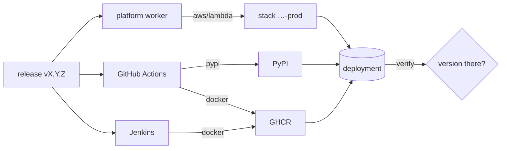

# Deployments

A deployment is a release arriving somewhere: a Lambda stack, PyPI, a container registry, a cluster. This guide is the model behind the Deployments tab, `action-platform deploy` and `POST /api/v1/apps/{id}/deploy` — what a target is, who executes a deploy, what the platform records about it and how it knows the version really got there. For how the cloud trusts the platform without keys, read [identity](concept_identity.md).



## One rule

**A deployment always references a release.** Whatever runs anywhere — the worker, a workflow, a Jenkins job, a person's terminal — it ships a tag `vX.Y.Z` (or `<component>/vX.Y.Z` for a component), never a branch or a working tree. A pipeline that publishes from a branch without naming a release — neither the tag it built nor a version parameter (below) — is a CI run, not a deployment, and the platform does not record it as one. What runs in the cloud is therefore always reproducible from the tag alone. Cutting a release is in [releases](concept_releases.md).

## Targets and executors

Two things that used to be one:

- the **target** is *where* the version goes — `aws/lambda`, `pypi`, `docker`, `npm`, `packagist`, `go`, …;
- the **executor** is *who* does the work — the platform's worker, a GitHub Actions workflow, a Jenkins job, or a person.

An app declares its targets in `platform.toml`, each with its executor:

```toml
[[deploy.targets]]
name = "lambda"
kind = "aws/lambda"
stages = ["dev", "prod"]
run_by = "platform"

[[deploy.targets]]
name = "pypi"
kind = "pypi"
run_by = "github_actions"
workflow = "publish.yml"
package = "action-platform"

[[deploy.targets]]
name = "ghcr"
kind = "docker"
run_by = "jenkins"
job = "team/app/publish"
image = "ghcr.io/actionplatform/api"
```

`run_by = "platform"` is the target the worker deploys itself through a plugin (below). `github_actions`, `gitlab_ci` and `bitbucket_pipelines` are *dispatched*: the deploy starts the target's `workflow` on the release tag with two inputs, `version` and `registry` — the registry the kind pairs with the scope's criticality: a `test` scope publishes to TestPyPI or the npm `next` dist-tag, any other to the registry itself; the scope's name is yours — follows the run in the job log until it ends, then asks the destination whether the version arrived — the pipeline publishes with its own credentials (trusted publishing, OIDC), the platform decides when and to which scope, and no registry token reaches it. `jenkins` is *observed* by default: the platform reads the builds of the job named on the target, turns each one that shipped a release into a deployment record, and verifies the version at the destination; with `observe = false` it is dispatched too ([below](#dispatched-jenkins-jobs)). `manual` is observed too: a person records what they shipped. `observe = true` on a `github_actions`, `gitlab_ci` or `bitbucket_pipelines` target makes it observed as well — for a pipeline that keeps deploying on its own, on a release tag: its runs are imported on **Sync** and verified, and a platform deploy never dispatches it (`observe` on a `platform` target is refused). The platform never runs an observed target: a deploy whose only matching targets are observed is refused with the executor named — `app-prod is deployed by jenkins; the platform records it, it does not run it`. `stages`, when present, limits a target to some scopes; `registry` on the target overrides the pairing. The registry kinds `pypi` (`package`), `npm` (`package`), `docker` (`image`), `packagist` (`package`, `vendor/name`) and `go` (`module`) are built into the core; other kinds come from plugins. The single `[deploy] target = "aws/lambda"` form is still read as one target named after its kind, run by the platform.

## The record

Every delivery is a row in `deployment`, whoever executed it:

| Field | What |
|---|---|
| `target`, `kind`, `stage` | which target of the app, and its stage when the target has stages |
| `version`, `sha` | the release — required |
| `status` | `queued` → `running` → `success` or `failure` → `verified` |
| `executor` | `platform`, `github_actions`, `gitlab_ci`, `bitbucket_pipelines`, `jenkins`, `manual` |
| `job_id` / `ci_run_id` | the worker job or the CI run that did it — the app's Activity (CI runs) shows the pipeline, this row shows the result |
| `url`, `actor`, `error`, `started_at`, `finished_at`, `verified_at` | where to look, who, why it failed, when |
| `release_id` | the release row of that version, linked when the platform knows it |

How a row is born depends on the executor:

| Executor | Source |
|---|---|
| `platform` | the worker writes it as the `deploy` job runs |
| `github_actions`, `gitlab_ci`, `bitbucket_pipelines` | the worker writes it as the `deploy` job dispatches the workflow and follows the run; a run of the same workflow started outside the platform on a release tag is imported on **Sync** unless the platform already recorded that version; with `observe = true`, every run on a release tag is imported and none is dispatched |
| `jenkins` | the builds of the target's `job` — version from the build's tag or parameter, scope from a parameter or the target's only stage ([below](#observed-builds)); with `observe = false`, the worker writes it as the `deploy` job starts the build and follows it |
| `manual` | `POST /api/v1/projects/{p}/apps/{a}/deployments`, `action-platform deploy-record`, the `record_deployment` tool |

## Observed builds

A Jenkins job that deploys on a release often checks out a branch and receives the release as a build parameter, so the build's git ref names no release. Two optional keys on an observed target read the parameters instead:

```toml
[[deploy.targets]]
name = "app-prod"
kind = "docker"
run_by = "jenkins"
job = "team/app-prod"
image = "ghcr.io/acme/app"
stages = ["prod"]
version_parameter = "RELEASE_TAG"

[[deploy.targets]]
name = "app"
kind = "docker"
run_by = "jenkins"
job = "team/app"
image = "ghcr.io/acme/app"
version_parameter = "RELEASE_TAG"
stage_parameter = "ENV"
```

- **Version.** The ref the build checked out wins when it is a release tag. Otherwise the value of `version_parameter` is the release: `v1.2.3`, `1.2.3` or `<component>/v1.2.3`. On a target with a `component`, a bare version is that component's; another component's tag is ignored. A build whose parameter names no release is not recorded.
- **Scope.** The value of `stage_parameter` when the build has it; otherwise the target's single entry in `stages` when it lists exactly one — the one-job-per-environment setup; otherwise the row has no scope. A run whose scope the target does not list in `stages` is not recorded on it, and the next sync removes the rows an earlier sync recorded that way — two targets on one job that tell scopes apart by `stage_parameter` each keep only the runs of their own scope.

Runs imported from a dispatched target carry no parameters, so their scope comes from a single entry in `stages` alone. Without the keys, a build is recorded only when it checked out a release tag, as before.

## Dispatched Jenkins jobs

A Jenkins job that already does the whole deploy — migrations, several destinations, its own checks — can be started from the platform instead of only watched. The platform is the button and the record; Jenkins keeps every credential.

```toml
[[deploy.targets]]
name = "lambda-prod"
kind = "aws/lambda"
run_by = "jenkins"
observe = false
job = "team/app-prod"
version_parameter = "RELEASE_TAG"
stages = ["prod-lambda"]

[[deploy.targets]]
name = "container-prod"
kind = "dokploy"
run_by = "jenkins"
observe = false
job = "team/app-prod"
version_parameter = "RELEASE_TAG"
stages = ["prod-container"]
```

- **Start.** A deploy calls the job's `buildWithParameters` with `version_parameter` set to the release tag and nothing else, with the credentials of the Jenkins server connected to the app (Connect → CI, then the app's Settings › CI) — never the source host's token. `version_parameter` is required.
- **Follow.** The job log shows the queue item becoming a build number, each pipeline stage as its status changes (`wfapi/describe`) and the build's result. A build cancelled in the queue fails the deploy at once.
- **Result.** The build's result is the deploy's: `SUCCESS` records `success`, anything else `failure`, and the row links to the build. The destination is asked later, on **Sync**, when the kind can answer.
- **One build, several scopes.** Dispatched targets on the same `job` without a `stage_parameter` are one build: a deploy to any of their scopes starts the job once and records a deployment for each target on its own scope.
- **Both ways in.** A build the job's own trigger started (a webhook on a release) is still imported on **Sync**, unless the platform already recorded that version for the target.
- **Long builds.** The worker keeps a running job's lock fresh, so a build that takes longer than the 30-minute reaper window is not handed to another worker — which would start the job again.

## Verified at the destination

A green pipeline says the job finished, not that the version is there. Every target kind knows how to check its destination for one version — `pypi` asks `pypi.org/pypi/<package>/<version>/json`, `docker` asks the registry for the tag's manifest, `npm` asks the registry, `packagist` looks for the version among those `repo.packagist.org/p2/<package>.json` lists, `go` asks the module proxy for `proxy.golang.org/<module>/@v/v<version>.info`, `aws/lambda` reads the stack's deployed version — and a deployment becomes `verified` when the check passes. The check runs after the executor reports success and again on **Sync**; a `success` that never verifies is shown as such.

## Stages

A stage is a **scope** — a name, a kind and a criticality you create under Deployments › Scopes ([scopes](concept_scopes.md)). No scope, no deploy: nothing is called `dev` or `prod` unless you name it so. Each scope is a separate deployment of the same repository — on `aws/lambda`, a separate CloudFormation stack named `ap-<org>-<project>-<app>-<scope>` — with its own history, its own URL and its own last deployed version. A scope receives whatever release its criticality accepts: one may run `1.4.0` while another is still on `1.3.2`, and nothing forces an order between them.

One deploy at a time per stage. While a deploy to a stage is queued or running, the API refuses another for the same stage with `409` (`a deploy to prod is already running; wait for it to finish`), the web disables the button and says why, and the CLI prints the same message. The other stage is free. The rule exists because the stack and the platform's clone are touched by one job at a time; two `sam deploy` on the same stack would corrupt its state.

## What is deployed

A deploy ships a release, never a working tree. The worker checks the tag `vX.Y.Z` out, builds and deploys that commit, and puts the branch back afterwards. Without a release there is nothing to deploy: the web lists the releases of the app, the CLI takes `--version` or the tag HEAD sits on, the API takes `version` in the body — anything else is refused. What runs in the cloud is therefore always reproducible from the tag alone. Cutting a release is in [releases](concept_releases.md).

## Targets run by the platform

A target with `run_by = "platform"` — or the single `[deploy]` form:

```toml
[deploy]
target = "aws/lambda"
region = "us-east-1"
```

— is a plugin — `aws/lambda` comes from [apx-aws-lambda](https://github.com/actionplatform/apx-aws-lambda), bundled in the API image — and it brings three things: a **cloud overlay** for the templates (the SAM template, a deploy workflow, a `/health` route, an adapter per language) applied by *Configuration → Deploy target* or `action-platform cloud set`; the **deploy steps** (`preflight`, `create`, `deploy`, `switch_traffic`, `delete`); and, when it needs settings, the **options** an organization fills in under Connect → Deploy (or the card of its kind) → Configure. The platform passes every option to the deploy as `AP_<PLUGIN>_<KEY>` — for `aws/lambda`, `AP_AWS_LAMBDA_ROLE_ARN` — with `AP_APP=<org>/<project>/<app>`, so the repository only needs `target`; a value under `[deploy]` in the repository still wins, except that a `url` option there must match the organization's connection — a repository never points the organization's credential at another host ([options](use_plugins.md#options)). The plugin contract is in [writing a plugin](contribute_plugins.md), the overlays in [templates](concept_templates.md).

## Readiness

Before anyone presses Deploy, a release knows whether it can reach a stage. Right after a release is cut on the platform, the deploy worker runs a `readiness` job for every scope of the app at the release tag and stores the answer per release and stage; **Re-check** on the release page runs it again, `action-platform readiness --stage <scope> --version X.Y.Z` runs it on a machine. Nothing is built or changed: the checks look, they do not act.

Two levels run today. **Static** checks come from the core and look at the repository at the tag: the stage is one of the app's scopes, the tag is `v1.2.3` or `component/v1.2.3`, every manifest the release process rewrites (`pyproject.toml`, `package.json`, `Cargo.toml`, `pom.xml`, …) declares the tag's version, and a manifest has its lockfile beside it (a warning, not a block). **Target** checks come from each deploy target's `readiness(ctx)`: `aws/lambda` proves the credentials work, the stack is not mid-operation or failed (a `ROLLBACK_COMPLETE` first creation is a warning — the deploy deletes it), the deploy role may do what the template needs — simulated with `iam:SimulatePrincipalPolicy` against the stack, the function, its log group, the execution role and every public layer the template references — and `sam validate --lint` passes; `pypi`, `npm`, `docker`, `packagist` and `go` refuse a version already at the destination. A target that raises becomes one failed check; a target with nothing to say adds none.

Observed targets are listed in `deploy.targets` as `app-prod (observed, jenkins)`, so an app deployed only by Jenkins or by hand is not blocked for having no target the platform runs. Each observed target whose kind has an installed provider runs its own checks, but they inform and never block: every one of them is a warning, since the platform will not run that deploy, and a registry reports a version already at the destination as the expected state, not as a conflict. A kind with no provider installed adds no target checks.

Each check carries an id (`aws.permissions`, `manifest.pyproject.toml`), a level, a severity — `error` blocks, `warning` informs — a detail and, when it fails, a fix. The verdict per stage is **Deployable** (no blocking failure), **Blocked** or **Checking**. Releases shows the verdict per stage, the release page lists the checks, the deploy form loads them for the release and stage picked and refuses to proceed while blocked unless *Deploy anyway* is ticked; the API does the same — `POST apps/{id}/deploy` answers `409` with the blocking checks unless the body says `force: true`. A release never checked passes the gate: it only trusts what it verified. Two further levels are named but not run yet: `plan` (a change set, a dry build) and `proof` (a deploy to `dev` verified at the destination) — a green readiness does not prove the code compiles.

## Preflight

**Run preflight** (`dry_run: true`, the default of the API body; `--dry-run` on the CLI) runs the target's checks and stops: the credentials can be obtained, the template renders, the toolchain is there. Nothing in the cloud changes. It answers on the request: no job is queued, the stage is not occupied and nothing is added to the history. Run it after connecting a new target or a new account; a deploy runs the same checks first anyway. Readiness is the same idea moved earlier — to the release, for every stage, stored — with more to say (permissions, the destination's state, the manifests).

## A deploy as a job

On the platform a deploy never runs on the request: the API answers `202` with a job id and the worker does the work.

| Step | Where | What |
|---|---|---|
| 1 | API | role ∩ scope ∩ reach (`app.release`), no live deploy for the stage, record whether the caller manages the organization |
| 2 | API | job `deploy` queued; the row is in the history at once |
| 3 | worker | claims the job, opens the clone, checks the tag out |
| 4 | worker | mints the app's identity token (`org:…:project:…:app:…`, stage, `org.manage` when step 1 said so) |
| 5 | target | preflight, then build and deploy with credentials obtained from the token — on AWS the connected account's deploy role, scoped to the app by the token's session tag |
| 6 | worker | result (URL, stack) or error on the job; the history row updates |

A job is one row in `job`: kind, status (`queued` → `running` → `done` or `failed`), payload, attempts, result or error. On PostgreSQL the enqueue sends `NOTIFY ap_jobs` and a worker listening on that channel claims within milliseconds; elsewhere it polls every two seconds. A live worker refreshes its job's lock every minute; one that dies mid-deploy leaves the job `running` until the reaper, 30 minutes after the last refresh, puts it back in the queue with `worker lost`; a job that crashes is retried up to three times with a growing delay (30 s, 60 s, 120 s); a job the platform refused — a missing tag, a target that said no — fails at once. The status the web shows is the row's. The tables are in [database](concept_database.md), the code path in [architecture](contribute_architecture.md#a-deploy-end-to-end).

## History

**Deployment history** lists the app's deployments newest first, one block per target: status, stage, type (Deploy, Tear down), version, executor, duration, who, when. For targets the platform runs it is the list of `deploy` and `destroy` jobs; for the others it is what the importers recorded, linked to the run that did it. A row expands into the summary, the full log, the run id, timestamps and **Redeploy**, which queues the same release to the same stage again. A failed row keeps the error and the log; nothing is deleted from the history when a stack goes away. `GET /api/v1/jobs?app=<registry id>&kinds=deploy,destroy&page=&per=` is the same list, paged (`jobs/page` answers too, deprecated). From a terminal, `action-platform deployments [--app <id or name>] [--sync]` prints each target with what arrived at it (`--sync` asks the observed pipelines first), and `action-platform logs <job> [--follow]` prints what the worker wrote for a job.

## Redeploy and rollback

Deploying an older release to a stage is the rollback: pick it in the Deploy card, or **Redeploy** on its row in the history. There is no separate state to restore; the tag is the state. `action-platform rollback --stage prod` from the CLI is the target's own undo — on `aws/lambda` a CloudFormation `rollback-stack` to the previous stack state, which cannot name a version; naming a version is refused there and a deploy of that release does the job.

## Leaving the cloud

Deleting an app offers **Also tear down `<target>`** (`?cloud=true`): the API queues a `destroy` job, the worker runs the target's `delete` for every stage — `sam delete` of each stack, with the execution role it created; only then the app leaves the platform. A failure leaves the app in place with the error on the history (*Tear down*). Deleting a project with **Delete stacks on the cloud** does the same for every app in one `destroy_project` job; the card says *Tearing down* meanwhile. `action-platform destroy` is the CLI's version for one target of the repository you are in.

Deleting without the option removes the app from the platform only; the stacks keep running, and the repository's own CI, when the overlay installed one, can still deploy on its own. Deleting the repository on the host is a separate checkbox of the same dialog — [web](use_web.md#deleting).

## Related

[Identity](concept_identity.md) — how the deploy gets credentials · [releases](concept_releases.md) — what a deploy ships · [CI](use_web.md#ci-servers) — the runs the observed executors come from · [templates](concept_templates.md) — the cloud overlays · [plugins](use_plugins.md) — configuring a target · [troubleshooting](start_troubleshooting.md) — when a deploy fails.
