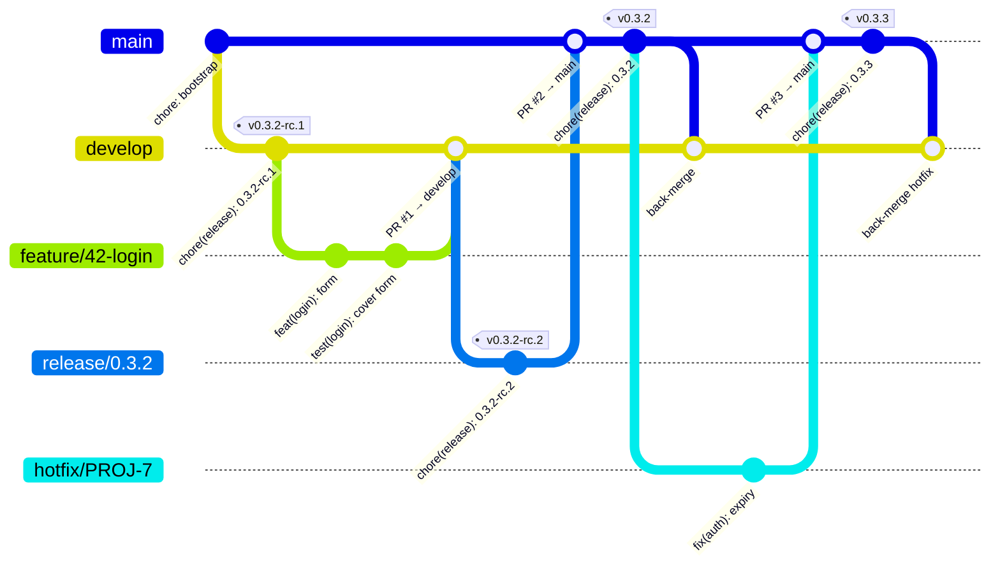

# Git-flow, enforced

One branch and commit model for every repository, checked by machines instead of reviewers.

Every project follows the same flow. Git hooks refuse the wrong move before it exists; CI refuses it on the pull request; the CLI and the MCP tools guide the right one.



| Branch | Starts from | Merges into | Release |
|--------|-------------|-------------|---------|
| `feature/<code>`, `bugfix/…`, `chore/…`, `docs/…`, `refactor/…`, `test/…`, `ci/…`, `perf/…` | `develop` (or the default branch when there is no `develop`) | `develop` | `X.Y.Z-rc.N` pre-release |
| `release/<version>` | `develop` | `main` and `develop` | `X.Y.Z-rc.N` until merged |
| `hotfix/<code>` | `main` | `main` and `develop` | `X.Y.Z-rc.N` until merged |
| `support/<code>` | `main` | — (no pull request target) | `X.Y.Z-rc.N` |
| `develop` | — | `main` | `X.Y.Z-rc.N` pre-release |
| `main` / `master` | — | — | stable `X.Y.Z` → PyPI / npm / … |

Rules the hooks, CI and the code host apply: branch names are `<kind>/<code>[-slug]`; commits are [Conventional Commits](https://www.conventionalcommits.org/en/v1.0.0/); no direct commits on `main`, `master` or `develop` except `chore(release):`, `chore(platform):` and the bootstrap commit; a pull request may only target what the table allows.

What the audit (`action-platform gitflow`, the app's *Branch policy* card) looks at: on a work branch, the commits since it left `develop`/`main`; on `main`, `master` or `develop`, the commits after the last tag — and once `platform.toml` is in the history, only those on the path down from the commit that added it. A repository imported with years of commits in another style is not asked to rewrite them, and merged pull requests are not "direct commits". The hooks, not the audit, are what stop a commit landing on a protected branch.

```bash
action-platform branch feature 42 login     # develop → pull → feature/42-login → push
action-platform gitflow                     # audit branch + commits
action-platform pr                          # target and body from the rules and the commits
action-platform release patch               # rc off main, stable on main
```

## Kinds

`feature bugfix hotfix release support chore docs refactor test ci perf` — branch names are `<kind>/<code>[-slug]`; `<code>` is the issue or ticket (`42`, `PROJ-7`, `0.3.2` for a release).

## Where the rules live

One implementation, four enforcers:

| Where | What |
|---|---|
| the code host (`[gitflow.protection]`) | GitHub, GitLab or Bitbucket itself refuses a direct push, a force push and a deletion on `main`, `master` and `develop`, and a merge whose checks did not pass — see below |
| the git hooks (`action-platform install`) | `pre-commit` refuses a branch name that is not git-flow; `commit-msg` refuses a non-conventional subject or a direct commit on a protected branch; `pre-push` refuses pushing a branch with a wrong name, or a protected branch with non-release commits |
| [ci-scripts](https://github.com/actionplatform/ci-scripts) `gitflow.sh` | the same checks on every pull request, from GitHub Actions, GitLab CI or Jenkins |
| the library | the rules as Python for the CLI, the MCP tools and the web app's audit |

Hooks you already had are kept: an existing `pre-commit`, `commit-msg` or `pre-push` that is not ours is renamed to `<name>.pre-action-platform` and still runs after the platform's check. When `core.hooksPath` points at an unversioned directory the hooks go there instead of `.git/hooks`; when it points at a versioned one (Husky's `.husky/`, lefthook) nothing is touched and git-flow is enforced by CI only — the CLI says so.

Commits allowed on protected branches: `chore(release): …`, `chore(platform): …` and `chore: bootstrap …`. Merge and revert commits are exempt from the Conventional Commit check, not from this rule.

## Enforced on the code host

The hooks can be skipped (`--no-verify`) and a check only advises until the host requires it. With `[gitflow.protection] enforce = true` the platform sets the rules on the code host itself, through the host's API, with the app's connection:

```toml
[gitflow.protection]
enforce = true
branches = ["main", "develop"]   # optional; default: whichever of main, master and develop the repository has
```

| Rule | GitHub | GitLab | Bitbucket Cloud |
|---|---|---|---|
| Direct push blocked, pull request required | ruleset `pull_request` rule | Premium: protected branch, push allowed to the platform's account only. Free: **not active** — Free cannot exempt one account, Maintainers keep push access | branch restriction `push`, the platform's account the only exception |
| Force push blocked | ruleset `non_fast_forward` | protected branch, `allow_force_push = false` | branch restriction `force` |
| Deletion blocked | ruleset `deletion` | protected branch (Maintainers can still delete one from the UI or API) | branch restriction `delete` |
| Required checks | ruleset `required_status_checks`: `gitflow`, `conventional-commit` and the app's CI contexts | "Pipelines must succeed" (the pipeline runs the `gitflow` and `conventional-commit` jobs) | `require_passing_builds_to_merge` + `enforce_merge_checks`: a count of passing builds, never a name; blocking only on Premium, which the platform cannot read, so it shows as check-based |
| Branch names `<kind>/<code>[-slug]` | Enterprise: ruleset `branch_name_pattern`; otherwise the required `gitflow` check | Premium: push rule `branch_name_regex`; otherwise the `gitflow` job | the `gitflow` step |
| Conventional Commits | Enterprise: ruleset `commit_message_pattern`; otherwise the required `conventional-commit` check | Premium: push rule `commit_message_regex`; otherwise the `conventional-commit` job | the `conventional-commit` step |

Each rule is reported as **native** (the host refuses it), **check** (a required CI check refuses it) or **inactive**, with the reason — a plan that lacks the feature, a permission the connection does not have, a check the repository's CI does not run. The platform never shows a rule as enforced when the host did not accept it.

**Required checks** are the ones the repository's CI really reports: `gitflow` and `conventional-commit` when the CI files on the protected branch declare jobs (GitHub Actions job name, GitLab CI job, Bitbucket step) by those names — the [templates](https://github.com/actionplatform/templates) ship them — plus, for an app whose CI is a Jenkins server, the status contexts that server reported on the last merged pull requests (`jenkins/ci`, say), plus the names listed in `[gitflow.protection] checks`. A detected check that never reports is never required: it would block every merge. A name in `checks` is required as written, so list only a context every pull request receives. Reading the contexts a server reported needs *Commit statuses: Read* on the GitHub App; without it, name them in `checks`.

**Who may still push.** Only the platform's own identity, so `chore(release)` commits still land:

- GitHub: the organization's GitHub App — the one *Create GitHub App* made under Connect → Git — as the ruleset's only bypass actor (`actor_type: Integration`, the app's id). The rulesets are read and applied, and a release on a protected repository is pushed, with an installation token of that app for the repository's owner: a push made with a user's token is attributed to the user, not to the app. The app needs *Administration: Read and write* (rulesets) and *Contents: Read and write* (the release push) on an installation that reaches the repository. Nothing is applied, and the status names the reason with the action that fixes it, when the organization has no GitHub App connection (*Create the GitHub App*), the platform does not hold the app's private key — an app set up before the platform kept the key created from the manifest, or one entered with *I already have one* (*Create the GitHub App again*), the app is not installed on the repository's owner (*Install*), or the installation lacks a permission (*Review the app's permissions*: accept the new permissions on the installation; if the app does not request them, add them under its *Permissions & events* first).
- GitLab (Premium) and Bitbucket: the account behind the app's connection (`GET /user`). Connect with an account that is the platform's — a bot user, a group or project access token on GitLab — not a person's: whoever that account is keeps push access.

Nobody else bypasses, owners and admins included.

**New apps** created on the platform get `enforce = true`. **Existing apps** — added, imported or adopted — stay off until enabled: per app in the app's Settings › Git (Branch protection), or for every app that does not say otherwise with the organization's default (Settings → Git rules, `PUT /api/v1/settings/protection`). A deploy never turns it on.

**Drift.** Every hour the worker reads the host of each enforced app; when the rules differ (a bypass actor added, a rule removed, a branch unprotected) it puts them back and writes an event in the app's Activity with what changed and, when the host says, who. Turning enforcement off stops that; what the host has stays until it is removed there.

Related: [Development standards](usecase_standards.md) · [Releases](concept_releases.md) · [platform.toml](concept_manifest.md) · [CLI › Git-flow](use_cli.md#git-flow)
