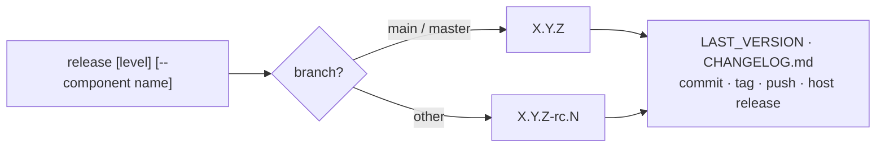

# Releases

A release is a version of a repository, or of one component of it: a tag, a changelog entry and a release on the code host. It is what a deploy ships. This page covers how a release is cut; where it goes is in [scopes](concept_scopes.md) and [deployments](concept_deployments.md).

## Overview

- The version lives in `LAST_VERSION` and follows semantic versioning.
- On `main` or `master`, a release is stable: `X.Y.Z`. On any other branch, it is a candidate: `X.Y.Z-rc.N`.
- The changelog is generated from the Conventional Commits since the last tag.
- One command does the rest: write the files, commit, tag, push, publish on the host.



## Getting started

```bash
action-platform release --dry-run      # the next version and its changelog
action-platform release minor          # patch (default), minor, major, or an exact X.Y.Z
action-platform release --rc           # force a candidate on main
```

In the web app: the app's **Releases** tab, **New release**. Over MCP: the `release` tool, a dry run by default.

## Components

A repository that ships several artifacts declares components in `platform.toml`. Each has its own path, `LAST_VERSION`, `CHANGELOG.md` and tag prefix:

```toml
[components.web]
path = "apps/web"

[components.api]
path = "apps/api/app"
```

| Parameter | Type | Required | Default | Description |
|---|---|---|---|---|
| `[components.<name>]` | table | no | — | one component; `<name>` is its tag prefix (`<name>/vX.Y.Z`) |
| `path` | string | no | the component's name | directory holding its `LAST_VERSION` and `CHANGELOG.md`; only commits that touch it enter its changelog |

`action-platform release --component api patch` cuts `api/vX.Y.Z`. Without `--component`, the release is the repository itself (`vX.Y.Z`), and its changelog excludes every component path. This repository uses three components; [Development › Releasing this repository](contribute_development.md#releasing-this-repository) shows them.

## What a release does

1. Refuses a dirty tree, a version that already exists, a tag that exists locally or on `origin`.
2. Computes the next version from `<path>/LAST_VERSION`, or from `0.0.0` when the component has never been tagged. On a branch other than `main`/`master` (or with `--rc`) it is `X.Y.Z-rc.N`, counting only that component's tags; `--stable` forces a stable version.
3. Renders the changelog from Conventional Commits since the component's last tag, limited to commits that touched `path`; the root excludes every component path.
4. Writes `LAST_VERSION`, prepends `CHANGELOG.md`, syncs `package.json` / `pyproject.toml` / `__version__` under `path`.
5. Commits `chore(release): [<name> ]X.Y.Z`, tags, pushes both, publishes the release on the source host (pre-release when rc). A refused push (the branch moved on the remote meanwhile) deletes the tag and the commit again, so nothing half-published stays in the workspace.
6. When a CI server (Jenkins) is connected to the app, starts its job with the new version as the `version` parameter, waits for it, and fails with `CI <name> failed` when the build fails.

In the web app the release card offers a **Component** field when `platform.toml` declares components — the repository itself or one of them, each with its own current version, tag prefix (`api/v…`) and changelog; the releases list badges every component release with its name and marks the latest of each. The CLI takes `--component`, the API and the remote MCP `release` tool `component`.

The hosted API syncs the workspace before step 1 (fetch, fast-forward, and a move to the remote when the branch had a leftover local commit), so the push in step 5 is never behind. The web form and the API also take a release **name** and Markdown **notes**, which go above the generated changelog in `CHANGELOG.md` and on the host.

`--dry-run` stops after step 3 and prints the version and changelog.

## Deploys ship releases

A deploy names a version — `action-platform deploy --version X.Y.Z`, the `version` field of `POST /api/v1/apps/{id}/deploy`, the release picked in the web — or takes the tag HEAD sits on; anything else is refused. The tag is checked out for the build and the deploy, so what runs in the cloud is always a commit the release process produced, reproducible from the tag alone.

One deploy at a time per scope: while a deploy to a scope is queued or running, the API refuses another for the same scope with `409`. The stack and the clone are touched by one job at a time; another scope goes ahead. On the platform a deploy never carries a cloud key: the worker signs a token about the app and the target exchanges it for credentials — see [identity](concept_identity.md).

## Readiness

A release carries, per scope, whether it can be deployed there: checked by the worker right after the release is cut, again on request, and stored on the release. Configuration, manifests, credentials, permissions and the destination's state are looked at; nothing is built. A blocked release is refused by the deploy unless forced. The checks, the levels and the gate are in [deployments › readiness](concept_deployments.md#readiness).

## The release table

The platform keeps one row per tag of an app in `release`, whoever named it first: `platform` when the release was cut here, the code host (`github`, `gitlab`, `bitbucket`, or any other importer) when it published one, `git` when the tag simply exists in the clone. The three merge by tag — a host or the platform enriches what git alone knew (name, notes, url, author), git never overrides a host — so a tag always has a row, on GitHub or on a plain git server. Each row carries its `component` and `version` (`web/v1.2.3` → `web`, `1.2.3`), and every [deployment](concept_deployments.md) references the row of the release it shipped.

## Limitations

- Versions are semantic (`[release] strategy = "semver"`) and changelogs come from Conventional Commits (`changelog = "conventional"`); commits in another format are left out of the changelog.
- A release publishes nothing to a registry or a cloud by itself. Publishing is a deployment of the release to a scope.

## Related

[Git-flow](concept_git_flow.md) · [Scopes](concept_scopes.md) · [Deployments](concept_deployments.md) · [platform.toml](concept_manifest.md)
