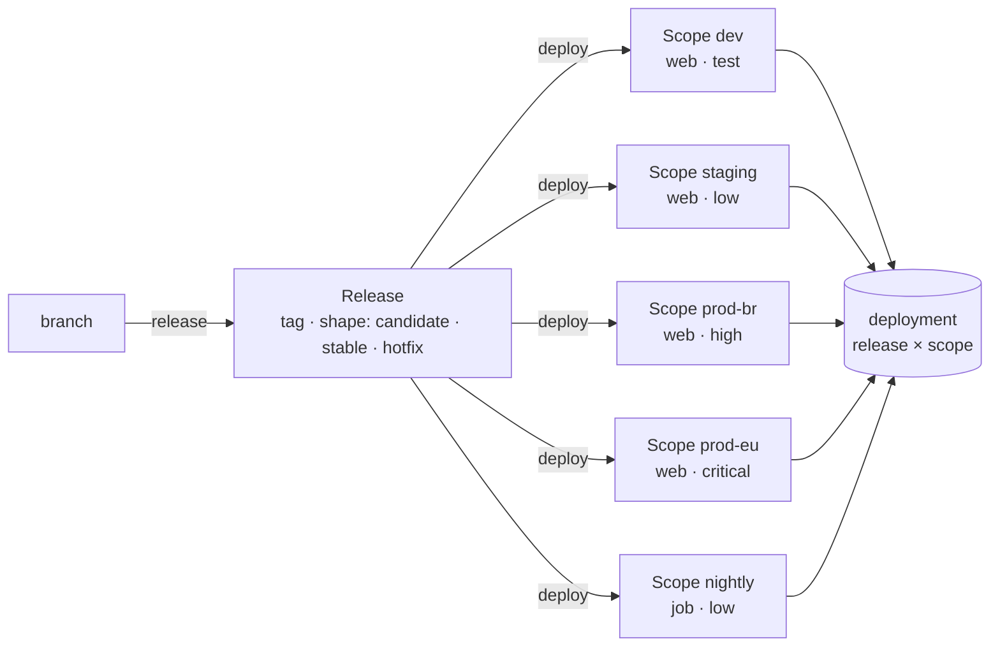
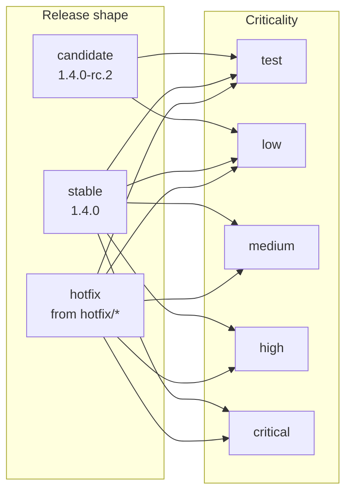
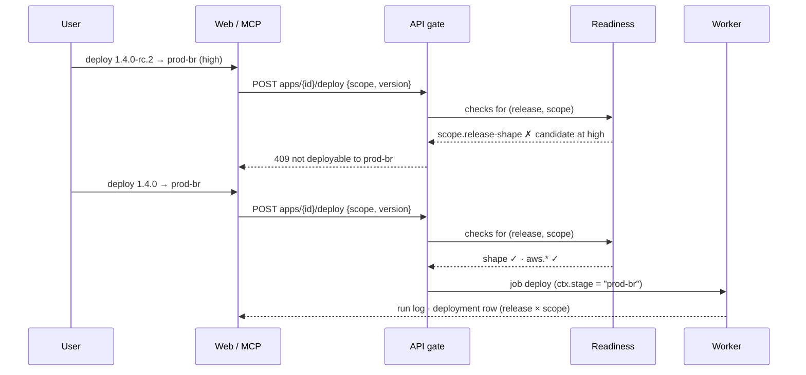
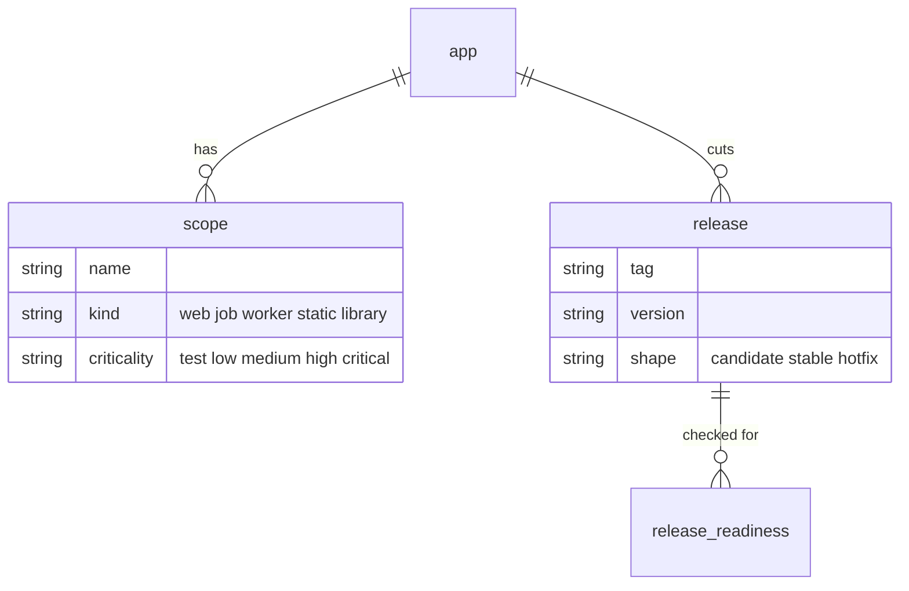

# Scopes

A **scope** is where a release is deployed. It has a name, a kind and a criticality — nothing else. A release exists without any scope — it is a tag, cut from a branch — but a deployment never exists without one: *deploy release X to scope S*. **No scope, no deploy.** Criticality is the rule that says which releases a scope may take.

Scopes replace the fixed `dev` / `prod` stages. An app starts with none and gets as many as it needs, each with its own criticality.

## Why

- `dev` and `prod` say *where*, never *how much it matters*. A staging that a customer demos from and a scratch environment nobody depends on are both "dev" today, and get the same rules.
- The rule "a deploy ships a release" ([ADR 0002](https://github.com/actionplatform/strategy/blob/main/adr/0002-targets-and-executors.md)) needs a second half: *which* release may reach *which* place. That half lives on the scope, as its criticality.
- Apps of different kinds deploy the same way but are operated differently: a web API, a scheduled job, a queue worker, a static site. The scope carries the kind so the platform can verify and diagnose each the right way.



## Definition

| Field | Meaning |
|---|---|
| `name` | unique within the app: `dev`, `staging`, `prod-eu`, `nightly-jobs` |
| `kind` | what runs there: `web` (answers HTTP), `job` (runs to completion on a schedule or a trigger), `worker` (consumes a queue), `static` (files behind a CDN), `library` (published to a registry, nothing runs) |
| `criticality` | `test` · `low` · `medium` · `high` · `critical` — see below |

An app has as many scopes as it needs, each with its own kind and criticality — nothing ties them to a ladder of names:

| App `orders-api` | kind | criticality |
|---|---|---|
| `dev` | web | test |
| `staging` | web | low |
| `prod-br` | web | high |
| `prod-eu` | web | critical |
| `nightly-reconcile` | job | low |

Two scopes may share a criticality (`prod-br` and `prod-eu` could both be `critical`) and a criticality may be absent (an app with only `dev` and `prod`). The rules below read the app's scopes as they are.

A scope belongs to an app. Two apps never share a scope. Where the release goes — the target, its region, its credentials — stays in the app's `[deploy]` configuration; the scope is the name the target receives as its stage.

## Criticality

| Value | Name | Definition |
|---|---|---|
| `test` | Test | No production use. Nobody depends on it. |
| `low` | Low | Little impact; downtime is tolerable. |
| `medium` | Medium | Affects processes, but a manual alternative exists. |
| `high` | High | Affects important operations and many users. |
| `critical` | Critical | Essential to the business: stops operations, causes financial loss or legal risk. |

Criticality is ordered: `test < low < medium < high < critical`.

## What a scope accepts




Releases come in three shapes: **candidates** (`1.4.0-rc.2`, cut off `main`), **stable** (`1.4.0`, cut on `main`) and **hotfixes** (a release cut from a `hotfix/<code>` branch, which git-flow starts from `main`). The default policy:

| Criticality | Candidates | Stable | Hotfix |
|---|---|---|---|
| `test` | yes | yes | yes |
| `low` | yes | yes | yes |
| `medium` | no | yes | yes |
| `high` | no | yes | yes |
| `critical` | no | yes | yes |

In words:

- **`test` accepts any release** — candidate, stable or hotfix.
- **A candidate is tried on `test` and `low`**; it never reaches `medium` or above.
- **A stable release serves any scope**, any version of it.
- **A hotfix goes anywhere**: production and every other level — that is what a hotfix is for.

The policy is this table, the same for every app; there is no setting that changes it.

## Where the rules run




The gate that refuses a deploy already exists — [readiness](concept_deployments.md#readiness) blocks a release the checks failed. Scope policy adds **static checks** to the same list, computed from what the platform already knows (the release row, the deployment rows, the scope):

| Check | Blocks when |
|---|---|
| `scope.release-shape` | a candidate aims at `medium`+; never for a stable release or a hotfix |

They show on the release page like every other check, per scope, and the deploy form refuses the same way (`409`, unless the request sets `force`).

## Relationship with the stage

Underneath, the platform still says *stage*: a scope's name is the stage. The plugin receives `ctx.stage = scope.name`, so `aws/lambda` names stacks `<prefix>-<scope>`, and `ctx.criticality` carries the scope's criticality.

| Where | Holds |
|---|---|
| `scope` table | the app's scopes: `name`, `kind`, `criticality`, unique per app |
| `release.shape` | `candidate`, `stable` or `hotfix` |
| `release_readiness.stage`, `deployment.stage` | the scope's name |
| `POST apps/{id}/deploy` | takes `scope`, or `stage` (the same thing) |
| `[[deploy.targets]]` | unchanged: *where* and *who*; the scope says what it is and how much it matters |

A deploy of one scope at a time: a second deploy to a scope with one running is refused.

A release stays what it is: a tag on the repository, one row in `release`, cut with no scope in mind. The row carries a `shape`, set when the platform cuts it: `hotfix` when the branch is `hotfix/*`, `candidate` for a version with a pre-release part (`-rc.N`), `stable` otherwise. A release imported from the code host has no branch to read, so its shape comes from the version alone: an imported hotfix is `stable`.

## Kinds

The kind says what runs at the scope: `web`, `job`, `worker`, `static` or `library`. It is recorded, validated and shown (the scope table, the `deploy.stage` readiness check); it does not change how a deploy is verified or diagnosed yet.

## Data model



```
scope(id, app_id, name, kind, criticality, created_by, created_at)
      unique (app_id, name)
release.shape                  candidate | stable | hotfix
release_readiness              one row per (release, stage), stage = the scope's name
```

An app has no scopes until someone creates them.

## Creating scopes

Three ways, all producing the same name, kind and criticality (kind defaults to `web`, criticality to `low`):

- **Web**: the app's **Scopes** tab, **New scope**.
- **MCP**: the `create_scope` tool on the hosted platform.
- **`platform.toml`**: `[[scopes]]` for a repository that deploys on its own (below).

Editing a scope changes its kind and criticality, never its name; deleting it is refused while a deploy to it is running. Both need `app.configure`.

## API

```
GET    projects/{p}/apps/{a}/scopes                      the app's scopes, with the kinds and criticalities that exist
POST   projects/{p}/apps/{a}/scopes                      {name, kind, criticality}
PUT    projects/{p}/apps/{a}/scopes/{name}               {kind, criticality}
DELETE projects/{p}/apps/{a}/scopes/{name}               refused while a deploy to it is running
POST   apps/{id}/deploy {scope, version, dry_run, force}  stage is accepted as the same thing
GET    projects/{p}/apps/{a}/releases/{tag}/readiness    one row per scope
POST   projects/{p}/apps/{a}/releases/{tag}/readiness    {stage?}: queue the check for one scope, or every scope
```

## Web

- **Scopes** tab on the app: the table of scopes — name, kind, criticality, what each accepts — and **New scope** (Name, Kind, Criticality). A scope's menu edits or deletes it.
- **Deploy**: pick the release and the scope; the form refuses a release the scope does not accept and a blocked readiness unless *Deploy anyway* is ticked.
- **Releases**: the release page lists the verdict and the checks per scope.
- Criticality badge tones: `test` and `low` neutral, `medium` warning, `high` and `critical` danger.

## CLI and MCP

```
action-platform scopes                                    list the [[scopes]] of platform.toml
action-platform deploy --scope prod-eu --version 1.4.0
action-platform readiness --scope prod-eu --version 1.4.0
```

`scopes` only reads the manifest; the CLI does not create scopes. `--scope` is the same option as `--stage`.

MCP, on a repository (reads `platform.toml`): `list_scopes`, `readiness`, `deploy`. On the hosted platform: `list_scopes`, `create_scope`, `update_scope`, `delete_scope`, `release_readiness`, `recheck_readiness`, `deploy`.

`platform.toml` for a repository deploying on its own:

```toml
[[scopes]]
name = "dev"
kind = "web"
criticality = "test"

[[scopes]]
name = "prod"
kind = "web"
criticality = "high"
```

`[deploy]` keeps saying where and who; a repository without `[[scopes]]` releases but does not deploy.

## Decisions

- Scope belongs to the app, not the organization: two apps' `prod` are two different places.
- Criticality is on the scope, not on the release: a release does not know where it goes; the same `1.4.0` is harmless on `low` and a business risk on `critical`.
- The ladder (`test < low < medium < high < critical`) and the policy table are fixed.
- Rules run as readiness checks: one gate, one place the user reads why a deploy is refused.
- `stage` survives as the plugin's view of a scope (`ctx.stage = scope.name`): no plugin changes, and stacks keep their names.
- A scope carries no target, region, url or executor: those belong to the deploy configuration and the cloud. The scope says what runs there and how much it matters.

Related: [Deployments](concept_deployments.md) · [Releases](concept_releases.md) · [ADR 0002](https://github.com/actionplatform/strategy/blob/main/adr/0002-targets-and-executors.md) · [ADR 0008](https://github.com/actionplatform/strategy/blob/main/adr/0008-release-readiness.md) · [ADR 0009](https://github.com/actionplatform/strategy/blob/main/adr/0009-scopes.md)
