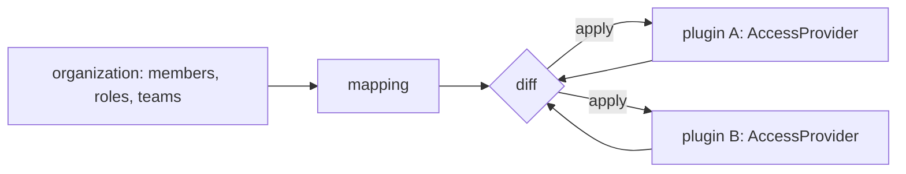

# Service access

[Access control](concept_access_control.md) says what a person may do on the platform. **Service access** keeps what the same people may do on the services the team works in — the code host's organization, the CI server, error tracking, the container host — in line with their role and teams on the platform: who has what, where it drifted, and one call to give, take or remove access everywhere.

The core holds the engine and the contract; each service's plugin owns its service, access being one of its capabilities. A platform with no such plugin has nothing to manage.

## How it works

- **A grant** is `(service, account, resource, level)`: `repo/api push` on GitHub, `folder/ci build` on Jenkins. Each service names its resource kinds and orders their levels; `access_audit` lists them.
- **Live state** is read from each service on every call; nothing is cached.
- **The mapping** links each member's email to an account per service and names the grants a platform role (`roles`), a team (`teams`) or one person (`grants`) carries; the access of accounts that belong to no member (bots, agencies) is kept as found (`keep`). It is the organization's, stored once on the platform, so everyone who manages access shares it.
- **A service is imported before it is managed.** The first `access_sync` that reads a service links members to accounts (an account that is the member's email links itself; other accounts are passed as `links`), records what the service holds today and changes nothing there. A sync right after is a no-op; from then on a member who leaves the organization, changes team or role, or is granted something shows up as drift. A service that could not be read stays unimported until a later sync reads it.
- **Dry run by default.** Every change answers with the plan; `apply` makes it.
- **Never the last administrator.** Each provider refuses, before anything is sent, a change that would leave its service without an administrator.
- Accounts compare without case.

## Operations

Every route needs `org.manage` and a token that is not limited to a project or app.

| MCP tool (remote) | Command | Route | Does |
|---|---|---|---|
| `access_audit` | `action-platform access audit` | `GET /api/v1/access/audit` | drift per service, members without an account, accounts that belong to no member, the resources and levels each service grants |
| `access_who` | `action-platform access who --person <email>` / `--service <name>` | `GET /api/v1/access/who` | a person's accounts, live grants and drift; or every account on a service and the member it belongs to |
| `access_grant` | `action-platform access grant <email> <service> <resource> <level>` | `POST /api/v1/access/grant` | one grant to one person, recorded in the mapping; only that person's account is touched; the grants the service needs beside it are added |
| `access_revoke` | `action-platform access revoke <email> <service> <resource>` | `POST /api/v1/access/revoke` | takes it away; says when the role or a team still grants it |
| `access_offboard` | `action-platform access offboard <email>` | `POST /api/v1/access/offboard` | every grant of every linked account, the mapping entries, optionally the platform membership |
| `access_sync` | `action-platform access sync` | `POST /api/v1/access/sync` | imports a service the first time; then adds, changes and removes to close the drift |

The operations run on the API, with the plugins the image bundles and each plugin's options of the caller's organization — credentials stay sealed on the platform and never reach the client. The CLI commands and the remote MCP tools call these routes; the local MCP server, which acts on files on one machine, has none of them.

## Where the pieces live

| Piece | Where |
|---|---|
| The contract a plugin implements | `action_platform.abc.AccessProvider` and `Plugin.access(options)` — [writing a plugin](contribute_plugins.md#access) |
| The engine (mapping, diff, import, plan) | `action_platform/core/service_access/` |
| Which providers exist for an organization | every enabled plugin whose `access(options)` returns a provider for that organization's options; one whose options are incomplete shows as a failed service with the reason |
| The mapping | the plugin options table, under `access` / `mapping` for the organization — `access` is therefore not a slug a plugin can take |
| Routes | `apps/api/app/api/routes/service_access.py` |
