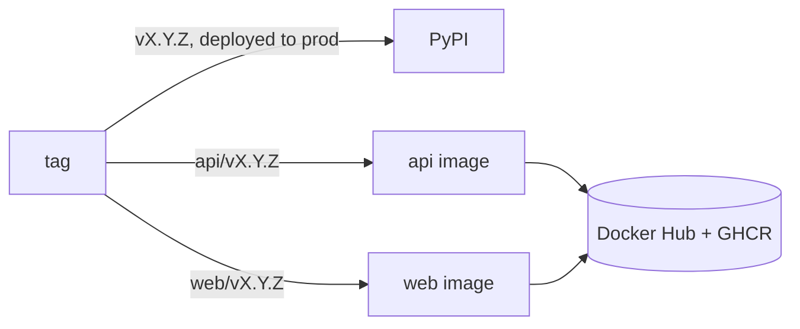

# Development

## Python

```bash
poetry install --extras mcp
poetry run pip install -e apps/api httpx httpx2  # the API package, editable, on top of the library
poetry run pytest -q                      # the library; or: python -m unittest discover -s tests -t .
(cd apps/api && ../../.venv/bin/python -m pytest -q)   # the API
poetry run ruff check . && poetry run ruff format --check .
(cd apps/web && npm run check)                     # lint, typecheck, tests, build
poetry run action-platform-api serve --reload            # reads .env in the current directory (AP_DATABASE_URL, AP_AUTH_SECRET, …)   # :7788, OpenAPI at /docs; without a token the API refuses to start unless told so
```

Tests use throwaway git repositories and a tiny templates index under `tmp_path`; nothing touches the network or the user's home.

## Web

```bash
cd apps/web
npm install
npm run dev            # :3000
npx tsc --noEmit
npm run api:types      # regenerate lib/api.d.ts from the Python app (no server needed)
```

The web app keeps no state: it needs `AP_API` (where the API listens) and `PUBLIC_URL`. Everything the wizard creates lands in the API's database (`AP_DATABASE_URL`); point it at a fresh SQLite file to start over.

Rules that come from mistakes already made:

- Never use `window.confirm` / `prompt` / `alert`; use `components/ui/dialog.tsx`.
- Client components must not import modules that call the API (`lib/api`, `lib/v1`, `lib/orgs`, `lib/source-hosts`, `lib/oauth`); shared types and constants live in `lib/types.ts`, `lib/permissions.ts` and `lib/source-host-kinds.ts`.
- Do not run `npm run build` while `npm run dev` is running — both write `.next/`.

## Repository conventions

Git-flow and Conventional Commits, enforced by the hooks `action-platform install` puts in `.git/hooks` and by CI. Work on `<kind>/<code>` branches, open a pull request, never commit on `master`. Releases are cut from `master` with `action-platform release [--component web|api]`; each component publishes on its own tag (see [releases](concept_releases.md)).

Toolchain: Python 3.13 (`.python-version`; the package supports 3.10 and newer) and Node 22 (`apps/web/.nvmrc`). Besides the tests, the API job of CI runs `lint-imports` against `.importlinter`, which enforces the layers described in [architecture](contribute_architecture.md).

## Releasing this repository

One repository, three components, three versions:

| Component | Path | Command | Tag | Publishes |
|---|---|---|---|---|
| library + CLI (root) | `.` | `action-platform release minor` | `v0.3.0` | `action-platform` on PyPI, when the release is deployed to the `prod` scope |
| api | `apps/api/app` | `action-platform release --component api patch` | `api/v0.1.2` | `actionplatformio/action-platform-api` (Docker Hub + GHCR) |
| web | `apps/web` | `action-platform release --component web minor` | `web/v0.2.0` | `actionplatformio/action-platform-web` (Docker Hub + GHCR) |



| Workflow | Trigger | Does |
|---|---|---|
| `python-publish-pypi.yml` (Publish) | dispatched by the platform when a release of the root component is deployed to a scope (`version`, `registry`) | checks out the tag, runs `poetry version` and `poetry build`, and uploads with `pypa/gh-action-pypi-publish` through a Trusted Publisher: environment `testpypi` for a `test` scope, `pypi` otherwise. A release alone publishes nothing ([deployments](concept_deployments.md)) |
| `docker-publish-images.yml` (Package Docker) | tag `api/v*` or `web/v*` (stable or `-rc.N`), or manual dispatch with a component | builds `deploy/Dockerfile.<component>`, pushes `:X.Y.Z` (and `:latest` for stable) to Docker Hub and GHCR. For a stable tag it then attaches `docker-compose.yml`, `docker-compose.dokploy.yml`, `env.example` and `dokploy-template.b64` to the release: the files of the `api/vX.Y.Z` tag with the images pinned to this release and the newest stable release of the other component (`deploy/release-assets.sh`) |
| `code-quality.yml` | pull requests to `main`, `master`, `develop` | the shared `ci-github` setup and check, then the API tests and `lint-imports`, and the web checks, each only when its files changed |
| `conventional-commit.yml`, `gitflow.yml` | pull requests | the shared `ci-github` commit and branch checks |
| `trivy.yml` | pull requests and pushes | `aquasecurity/trivy-action` |

Secrets: `DOCKERHUB_USERNAME`, `DOCKERHUB_TOKEN` (read & write); variable `DOCKERHUB_NAMESPACE` when the Hub account is not `actionplatformio`. GHCR uses `GITHUB_TOKEN`.

The web app's API client is generated from the API's OpenAPI schema. Ship `api` and `web` together when the contract changes; a web image older than the API it talks to may miss fields, and the reverse is not guaranteed.

## Tests

`tests/` mirrors the package: `tests/core/flow/test_branching.py` and `test_pullrequest.py` cover `action_platform/core/flow/workflow.py` (`GitFlow`), `tests/core/flow/test_git.py` covers the policies in `git.py`, `apps/api/tests/services/test_releases.py` covers `apps/api/app/services/releases/`, `tests/repositories/` the data access, and so on — the API tests mirror its contexts. Every module is a set of `unittest.TestCase` classes, one per behaviour group; pytest is only the runner. Shared builders live in `action_platform/testing/fixtures.py` (re-exported by `tests/support.py`) (`TempCase` with a temporary directory and an isolated environment, `git()`, `repo_with_origin()`, `platform_repo()`, `template_repo()`), `apps/api/tests/support.py` (`ApiCase`: a `TestClient` over a fresh API with a platform project reachable as `file://`) and `tests/mcp/support.py` (`McpCase`: a local server over a tiny templates index).

## Web tests

`cd apps/web && npm test` runs Vitest (jsdom, Testing Library): `*.test.ts(x)` next to what they test — `lib/safe-path`, `lib/result` (`failed()` never shows an unexpected error's text), `lib/time`, the release version helpers, the run-alert summary, and the app wizard hook (`useAppWizard`: navigation, derived fields, clouds per template). `npm run check` runs lint, typecheck, tests and the build, as CI does.
