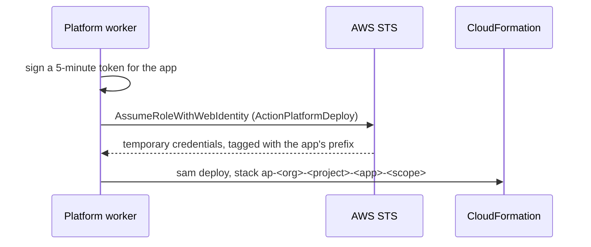

# Deploy to AWS Lambda

Connect an AWS account once, then deploy any web app of the organization to Lambda with no AWS access key on the platform, on a laptop or in a repository. Why this works without keys is in [Cloud identity](concept_identity.md).

## Before you start

- A hosted platform with a public HTTPS URL (`AP_PUBLIC_URL`). AWS fetches the platform's signing keys from `https://<platform>/.well-known/jwks.json`.
- A `web` app in Python, Node, Go, Java, Kotlin or Ruby. Every `web` template of the official repository deploys to Lambda.
- An IAM user or role in the AWS account that may create IAM resources, for the one-time connect step. Not the root account.

## How it works



The connect stack creates three IAM resources in your account and nothing else: an OIDC provider that trusts the platform, the `ActionPlatformDeploy` role, and the `ActionPlatformAppBoundary` policy that caps every execution role an app creates.

## 1. Connect the AWS account

On the platform, go to **Connect → Deploy → AWS Lambda → Configure** and press **Connect AWS**. The button copies a command and opens AWS CloudShell. Sign in, paste the command and press Enter. It deploys the stack `action-platform-connect` in `us-east-1` with the platform's URL and the organization's slug, and prints the account ID.

Without the button, from a machine signed in to the account:

```bash
action-platform plugin install aws-lambda
action-platform aws-lambda connect https://platform.example.com acme
```

`acme` is the organization's slug. `--region`, `--stack-name` and `--oidc-provider-arn` (for an account that already has an OIDC provider for the platform) are optional.

## 2. Tell the platform

In the same card, set **AWS account ID** to the 12 digits the command printed. The stack's `DeployRoleArn` output works too. From then on, every app of the organization whose target is `aws/lambda` deploys through this account. Nothing is registered per app.

## 3. Apply the overlay

In the app, open **Settings › Deploy**, pick **Deploy target** `aws/lambda` and apply it. The overlay files become pending changes:

| File | Purpose |
|---|---|
| `template.yaml` | the SAM template: function, HTTP API, the Lambda Web Adapter layer |
| `samconfig.toml` | SAM settings per environment |
| `Makefile` | one line, `ap-build package` |
| `requirements/` | example IAM policies |
| `.github/workflows/deploy.yml` | optional; deploys with GitHub's own OIDC. Delete it when the platform deploys |

Press **Commit changes** and merge the pull request. From a terminal, `action-platform cloud set aws/lambda` applies the same overlay.

Optional keys under `[deploy]`:

| Parameter | Type | Required | Default | Description |
|---|---|---|---|---|
| `target` | string | yes | — | `aws/lambda` |
| `region` | string | no | `samconfig.toml`, else `AWS_REGION` | AWS region of the stacks |
| `health` | string | no | `/health` | path checked through the HTTP API after the deploy; `""` skips it |
| `role_arn` | string | no | — | a role of your own to assume instead of the connected account |

## 4. Create scopes

Open the app's **Scopes** tab and create `dev` (`web`, `low`) and `prod` (`web`, `high`). Each scope is its own CloudFormation stack, `ap-<org>-<project>-<app>-<scope>`. The `prod` scope deploys with `sam deploy --config-env prod`; every other scope uses the `default` environment of `samconfig.toml`.

## 5. Release and read readiness

Cut a release on **Releases → New release**. The worker then runs the Lambda readiness checks for each scope, without building:

| Check | Verifies |
|---|---|
| `tool.sam`, `tool.aws` | the SAM and AWS CLIs are available |
| `template.present` | the overlay is applied |
| `stack.name` | the stack name resolves |
| `aws.credentials` | the deploy role can be assumed |
| `template.boundary` | the template takes `PermissionsBoundaryArn` and `RolePath` (connected account) |
| `stack.state` | the stack is not mid-operation or failed; a failed first creation is a warning, the deploy deletes it |
| `aws.permissions` | the deploy role may do what the template needs, simulated with `iam:SimulatePrincipalPolicy` |
| `template.valid` | `sam validate --lint` passes |

## 6. Deploy

Open **Deployments → New deployment**, pick the release and the scope, **Run preflight**, then **Deploy to dev**. The log shows every line `sam build` and `sam deploy` print. After the deploy, the platform calls the health path through the HTTP API and reads the stack's deployed version; the deployment becomes **verified** when it matches.

## From a terminal

```bash
action-platform plugin install aws-lambda
action-platform readiness --scope dev --version 0.2.0-rc.1
action-platform deploy --scope dev --version 0.2.0-rc.1 --dry-run
action-platform deploy --scope dev --version 0.2.0-rc.1
action-platform diagnose --scope dev
```

The connected account is used by deploys the platform runs. On your machine, the target assumes `[deploy] role_arn` with a token from your `action-platform login`, or uses the AWS CLI's own credentials (SSO, a profile, an instance role). Scopes come from `[[scopes]]` in `platform.toml` ([Scopes › CLI and MCP](concept_scopes.md#cli-and-mcp)).

## Roll back and tear down

- **Roll back:** deploy an older release to the scope, or **Redeploy** its row. `action-platform rollback --scope prod` runs CloudFormation `rollback-stack` to the previous stack state and cannot name a version.
- **Tear down:** delete the app with **Also tear down `aws/lambda`**, or run `action-platform destroy --scope dev`. It runs `sam delete` for the stack and the execution role SAM created.

## Limits

- API Gateway permissions and the SAM artifact bucket are shared within the account. Stacks, functions, layers, log groups and execution roles are scoped per app by the session tag.
- An overlay applied before the connected account existed lacks `PermissionsBoundaryArn` and `RolePath`. `template.boundary` blocks it. Apply the overlay again.
- After a plugin upgrade that changes the connect template, press **Connect AWS** again. CloudFormation updates the stack in place and the account ID stays the same.

## Related

[Cloud identity](concept_identity.md) · [Deployments](concept_deployments.md) · [Scopes](concept_scopes.md) · [apx-aws-lambda README](https://github.com/actionplatform/apx-aws-lambda)
