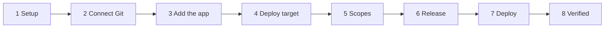

# Deploy from the web

From a fresh instance to a verified deployment, in the browser. Each step names the page with the details. The short path from a terminal is the [Quickstart](start_getting_started.md).

**Before you start:** a running instance ([Self-hosting](start_self_hosting.md)), an account on GitHub, GitLab or Bitbucket, and a destination: an AWS account for `aws/lambda` or a Dokploy server for `dokploy`.



## 1. Finish the setup wizard

Open the instance. Until an account exists, `/setup` is open, and the first account needs the **setup token**. `install.sh` prints it at the end. `docker compose exec api action-platform-api setup token` prints it again (on Dokploy, run `action-platform-api setup token` in the `ap-api` terminal). `AP_SETUP_TOKEN` replaces the derived token with one of your own.

The wizard runs four steps:

1. **API** checks that the API is reachable.
2. **Admin** creates the first account. Public sign-up stays closed; everyone else joins by invitation.
3. **Organization** takes the name, the slug and the commit author name and email.
4. **Source hosts** connects a code host, or skips.

Once an account exists, the token stops working and `/setup` sends anyone not signed in to `/login`. Details: [Self-hosting › First run](start_self_hosting.md#first-run), [Web › First run](use_web.md#first-run-the-setup-wizard).

## 2. Connect a code host and the webhook

Go to **Connect → Git**.

- **GitHub:** *Create GitHub App* opens GitHub with the manifest filled in. Confirm, install the app on the account or organization whose repositories it should manage, then connect. The app is created with *Actions: Read and write*, which the platform needs to start workflows.
- **GitLab and Bitbucket:** connect with an OAuth app or *Add with a token*.

Then open **Webhook…** on the connected account. It shows the payload URL and a secret, shown once. Paste both on the host. Every push, pull request, release and pipeline run then syncs the app within seconds. Without the webhook, **Sync** on the app page is the only way new activity arrives. [Web › Git](use_web.md#git).

## 3. Add the app

Go to **Projects → New project**, then open the project and press **New app**.

- **From a template:** pick Type, Stack and Template, then Configure (name, source host, repository owner, visibility) and Review. The platform creates the repository on the host, pushes `main` and registers the app.
- **From an existing repository:** use *Add an existing repository* at the top of the same page, with a git URL. A repository without `platform.toml` opens on **Settings › Deploy** with `platform.toml`, the quality config, the CI files and the hooks as pending changes. **Commit changes** puts them on a `chore/<code>` branch with a pull request. Merging it makes the repository an installed app.

Many repositories at once: **Adoption** on the project page. [Adopting repositories](use_adopting.md).

## 4. Configure a deploy target

The platform runs a target itself through a plugin bundled in its image. First fill the plugin's options under **Connect → Deploy**, on the plugin's card, **Configure** ([Plugins › On the hosted platform](use_plugins.md#on-the-hosted-platform)).

**AWS Lambda** (`aws/lambda`). Connect your AWS account once with the plugin's IAM-only stack, then paste its account ID (or the `DeployRoleArn` output) in the card. No cloud key reaches the platform. Step by step: [Deploy to AWS Lambda](guide_aws_lambda.md).

**Dokploy** (`dokploy`):

| Option | What |
|---|---|
| **Dokploy URL** | where the dashboard answers, `https://dokploy.example.com` (a `[deploy] url` in the app overrides it) |
| **API key** | Settings → API Keys in Dokploy, without a rate limit |
| **Registry username**, **Registry password** | only for a private image: a GitHub token with `read:packages` for ghcr.io |

Dokploy never builds. The overlay adds a workflow that publishes `ghcr.io/<owner>/<repo>:<version>` on every published release (GitHub CI only; another CI must publish `<image>:<version>` itself). The deploy points a Dokploy application at that tag and follows it to the end. The Dokploy project is `[project] name`, the environment is the scope, the application is `<name>-<scope>`. `[deploy.domains]` gives each scope a domain, and `[deploy] port`, `health` and `image` tune the rest. Every key and the requirements (Dokploy 0.20 or newer): the [apx-dokploy](https://github.com/actionplatform/apx-dokploy) README.

Then, in the app, open **Settings › Deploy** and pick the **Deploy target**. Applying it writes the cloud overlay as pending changes and records `[deploy] target`. Commit the changes and merge the pull request, as in step 3.

## 5. Create scopes

An app starts with no scope, and **no scope, no deploy**. Open the app's **Scopes** tab and press **New scope**. Create two:

| Scope | Kind | Criticality | Accepts |
|---|---|---|---|
| `dev` | `web` | `low` | release candidates, stable and hotfix releases |
| `prod` | `web` | `high` | stable and hotfix releases only |

`test` and `low` accept any release; `medium`, `high` and `critical` refuse a candidate. The scope's name is what the target receives: the Lambda stack is `<prefix>-<scope>`, the Dokploy environment is the scope. [Scopes](concept_scopes.md).

## 6. Cut a release and read readiness

1. Open **Releases → New release** on `develop`. A branch other than `main` or `master` cuts a release candidate `X.Y.Z-rc.N`. **Preview changelog** is the dry run. **Create X.Y.Z-rc.N** tags, pushes and publishes it. [Releases](concept_releases.md).
2. Right after the release, the worker checks it for every scope. The release's **Timeline & readiness** page shows each scope's verdict, lists each check with its fix, and **Re-check** runs them again. [Readiness](concept_deployments.md#readiness).

## 7. Deploy

Open **Deployments → New deployment**. Pick the release `X.Y.Z-rc.N` and the scope `dev`. **Run preflight** runs the checks only. **Deploy to dev** queues the job, and the deploy log follows the worker.

A blocked release does not deploy until you tick *Deploy anyway*; the API answers `409` the same way without `force`.

For production, merge to `main`, cut the stable `X.Y.Z` there and deploy it to `prod`. A candidate aimed at `prod` is refused by the `scope.release-shape` check.

## 8. Check the deployment

The **Deployments** tab lists every deploy with its status. A deployment moves `queued` → `running` → `success`, then **verified** once the platform has found that exact version at the destination ([Verified at the destination](concept_deployments.md#verified-at-the-destination)). `success` without `verified` means the pipeline ended but the version is not there. A row opens the run, the endpoint and the log. **Redeploy** repeats it. Deploying an older release is the rollback.

## Optional: connect CI

Open the app's **Settings › CI** and pick the runner and the job:

| Runner | Job |
|---|---|
| a **CI server** added under **Connect → CI** → Servers (Jenkins: base URL, user, API token) | the path in the Jenkins URL: `team/app`, or `team/app/main` for a multibranch branch |
| the CI built into the source host: GitHub Actions, GitLab CI, Bitbucket Pipelines (the host's own token, nothing to add) | a workflow file such as `ci.yml` for GitHub Actions (empty means every workflow); nothing for GitLab and Bitbucket |

Once connected, the **Pipelines** tab lists the runs, read live from the CI. Overview shows the latest run of the current branch, Releases shows the run of each release, and **Run CI** on Overview starts the job on a branch or tag. This is the *observed* side: the platform reads what the CI does. A deploy can also be *dispatched* through CI, a workflow or Jenkins job the platform starts on a release tag. That is declared as a deploy target, not here: [Targets and executors](concept_deployments.md#targets-and-executors).

## Do the same from the terminal

Point the CLI and an AI agent at the hosted platform:

```bash
action-platform login https://<platform> --scope read,write,release
action-platform whoami
action-platform mcp --remote
```

`login` opens the browser to approve a code and lets you choose where the token may act. With that token an agent can run the web steps above through the remote tools `create_scope`, `release`, `release_readiness`, `deploy` and `list_deployments`. What a token may do is your role narrowed by its scope and reach: [Access control](concept_access_control.md).

## Next steps

- [Deploy to AWS Lambda](guide_aws_lambda.md) for the connected account in detail.
- [Adopting repositories](use_adopting.md) for repositories, tags and pipelines you already have.
- [Deployments](concept_deployments.md) for targets, executors, readiness and history.
