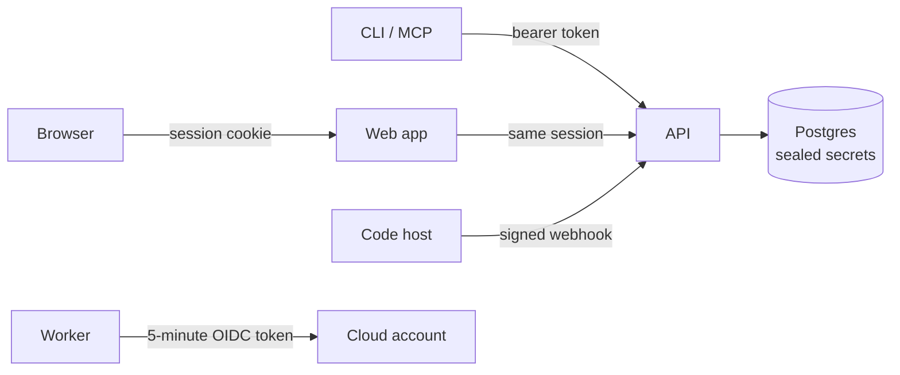

# Security

How the platform authenticates people and programs, protects secrets, verifies webhooks and reaches the cloud. Each item states what the code does today. Reporting a vulnerability is in [SECURITY.md](../SECURITY.md).

## Model

The web app is a client of the API. Every permission decision is made by the API: the caller's role in the organization, narrowed by the token's scope and reach. [Access control](concept_access_control.md).

## People

| Item | Behaviour |
|---|---|
| Sign-up | closed. The first account needs the setup token derived from `AP_AUTH_SECRET` (or `AP_SETUP_TOKEN`), compared in constant time. Everyone else joins by invitation |
| Passwords | scrypt (N=16384, r=16, p=1, 64-byte key) with a random salt, NFKC-normalised, compared in constant time; at least 8 characters |
| Google sign-in | optional (`AP_GOOGLE_CLIENT_ID`, `AP_GOOGLE_CLIENT_SECRET`); signs in an existing account or one with a pending invitation |
| Sessions | random token, 7-day lifetime refreshed after one day; the cookie is HMAC-SHA256 signed, `httpOnly`, `SameSite=Lax`, `Secure` behind HTTPS. A disabled user's sessions are deleted on use |
| Password reset | a link valid 30 minutes, sent only when SMTP is configured. Setting the new password signs out every session and revokes every API token of the account |
| Rate limits | per client IP and per API process: sign-in, sign-up, password change, forgot, reset, Google, device code and device token |

## Programs

| Item | Behaviour |
|---|---|
| API tokens | minted by `action-platform login` (browser device flow) or the web app; HS256 JWT signed with a subkey of `AP_AUTH_SECRET`. The JWT itself is not stored; its id is looked up on every call, so revoking it takes effect at once |
| Lifetime | 90 days; 30 days with the `admin` scope |
| Scope and reach | `read`, `write`, `release`, `admin`; one organization or all, optionally one project or one app. Never more than the owner's role |
| Visibility | **Team → Sessions** (the key icon *Connected apps* next to your name) lists each token, the programs seen using it and every browser session, all revocable |
| Shared API secret | routes outside `/api/v1/` and `/api/auth/` require `Authorization: Bearer <AP_API_TOKEN>`, compared in constant time. The API refuses to start without it unless `AP_ALLOW_UNAUTHENTICATED=1`. Open paths: `/api/version`, `/api/health`, `/docs`, `/redoc`, `/openapi.json`, `/.well-known/openid-configuration`, `/.well-known/jwks.json` |

## Secrets at rest

`AP_AUTH_SECRET` is the root secret. Per-purpose subkeys are derived from it with HKDF. Source-host tokens, CI server tokens, OAuth app secrets and keys, webhook secrets, plugin secrets and the OIDC private key are sealed with AES-256-GCM before they reach the database. Plugin secrets stored in plain text by an older version are sealed on boot. Losing or rotating the secret: [Operations](start_operations.md#losing-the-auth-secret).

## Web requests

| Item | Behaviour |
|---|---|
| Cross-site requests | a mutating `/api/v1` call without an `Authorization` header is refused when its `Origin` or `Referer` names another host |
| Content Security Policy | per-request nonce, `strict-dynamic`, `frame-ancestors 'none'`, `base-uri 'self'` |
| CORS | off unless `AP_CORS` lists origins |
| Proxies | `X-Forwarded-For` is trusted only from `AP_TRUSTED_PROXIES` (private ranges by default) |

## Webhooks

| Host | Verification |
|---|---|
| GitHub | `X-Hub-Signature-256` HMAC |
| Bitbucket | `X-Hub-Signature` (SHA-256) HMAC |
| GitLab | `X-Gitlab-Token` |

All compare in constant time. A host with no stored secret is refused. Webhook bodies are capped at 2 MB.

## Templates and plugins

- Templates from repositories other than the official one render in a separate process, with a sandboxed Jinja environment, no hooks, no platform secrets in the environment and symlinks confined to the template. [Templates › How a template is rendered](concept_templates.md#how-a-template-is-rendered).
- A plugin is Python code that runs inside the API and the worker. Install only plugins you trust. [Plugins › Trust](use_plugins.md#trust).

## Network and logs

- Outbound calls from the API and the worker refuse private and link-local destinations unless `AP_ALLOW_PRIVATE_NETWORKS` allows them.
- CI logs passed through the platform are masked for known secret shapes (tokens, keys, `Authorization` headers).

## Cloud access

The platform stores no cloud access key. For a deploy, the worker signs an RS256 token about one app, valid five minutes. On AWS, the connected account exchanges it for one-hour credentials on the `ActionPlatformDeploy` role, limited by a session tag to the app's own stacks, functions, layers, log groups and execution roles. Execution roles are created only under the app's path and with the `ActionPlatformAppBoundary` permissions boundary. [Cloud identity](concept_identity.md).

## What is recorded

There is no general audit log. The platform keeps:

- the deployment history, with the executor and the person who deployed;
- job logs of every sync, release, readiness check, deploy and tear-down;
- branch protection events, including drift and who changed it when the host says;
- the programs seen using each API token;
- the activity feed of releases, deployments, CI runs and pull requests.

`access audit` compares access on GitHub and other services with the roles on the platform. It reports drift; it is not an audit trail. [Service access](concept_service_access.md).
