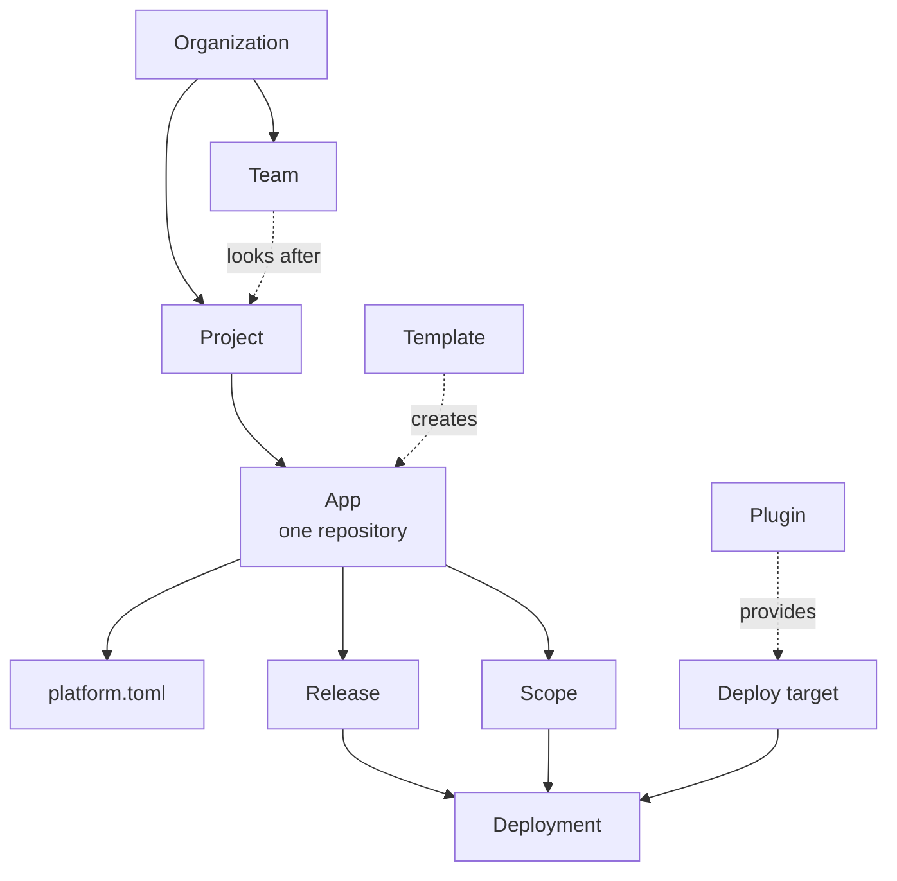

# Core concepts

The terms the platform uses, what each one is responsible for, and how they relate. Each section links to the page with the details. Short definitions of every other term are in the [glossary](resource_glossary.md).

## Organization

**Definition.** The tenant of a platform instance.

**Responsibility.** It holds the members and their roles, teams, projects, connections to code hosts and CI servers, template repositories and plugin settings.

**Relationships.** One instance hosts many organizations. A person can belong to several, with a role in each.

**Example.** `acme`, with members in the roles `owner`, `admin`, `deployer`, `developer` and `viewer`.

[Access control](concept_access_control.md)

## Team

**Definition.** A group of members of an organization.

**Responsibility.** It looks after projects. A project belongs to at most one team.

**Example.** The `payments` team looks after the `checkout` project.

[Web › Team](use_web.md#team)

## Project

**Definition.** A group of apps that ship together.

**Responsibility.** It groups apps for navigation, adoption and tear-down. It has no repository of its own.

**Example.** The `checkout` project holds `checkout-api`, `checkout-web` and `checkout-worker`.

[Web › Projects](use_web.md#projects)

## App

**Definition.** One git repository on a code host, registered on the platform.

**Responsibility.** It is the unit that is branched, released and deployed. The platform keeps a disposable clone of it, rebuilt from the remote when it needs the files, and stores its configuration.

**Relationships.** An app belongs to one project. It has releases, scopes and deployments. One repository can release several **components** (for example `api` and `web`), each with its own version and tags.

**Example.** `checkout-api`, the repository `acme/checkout-api` on GitHub.

[Web › The app page](use_web.md#the-app-page)

## Template

**Definition.** A project skeleton, chosen by type, stack and template: `web` › `python` › `fastapi`.

**Responsibility.** It creates a new app with code, tests, lint, CI and `platform.toml` in place. An **overlay** adds files on top of an app: a cloud (`aws/lambda`, `dokploy`, `docker`) or a **service** such as `postgres`.

**Relationships.** Templates come from the official repository or from template repositories an organization adds. A template is used once, at creation; the app does not follow later template changes.

**Example.** `action-platform init web python fastapi --name orders --cloud aws/lambda`.

[Templates](concept_templates.md)

## Manifest (`platform.toml`)

**Definition.** The file at the root of a repository that declares the project.

**Responsibility.** It names the project type and language, the code host, the deploy targets, the scopes, the components and the branch protection rules.

**Relationships.** The CLI, the git hooks and CI read the file. The hosted platform keeps its own copy of the same tables per app and syncs it with the file.

[platform.toml](concept_manifest.md)

## Git-flow

**Definition.** The branch and commit rules every app follows.

**Responsibility.** Branches are `<kind>/<code>[-slug]`. Commits follow Conventional Commits. `main`, `master` and `develop` take no direct commits. Each kind has a fixed base branch and pull request target.

**Relationships.** Git hooks, CI and the code host enforce the rules. The changelog of every release is built from the commit messages.

**Example.** `action-platform branch feature 42 login` creates `feature/42-login` from `develop`.

[Git-flow](concept_git_flow.md)

## Release

**Definition.** A version of an app or of one of its components: a tag, a changelog entry and a release on the code host.

**Responsibility.** It fixes what can be deployed. Its **shape** is `stable` (cut on `main` or `master`), `candidate` (`X.Y.Z-rc.N`, cut on any other branch) or `hotfix` (cut on a `hotfix/*` branch).

**Relationships.** A release belongs to an app. It exists without any scope. Readiness is checked per release and per scope.

**Example.** `v1.4.0-rc.1` cut on `develop`, then `v1.4.0` cut on `main`.

[Releases](concept_releases.md)

## Scope

**Definition.** A named destination of an app, with a kind and a criticality.

**Responsibility.** Its criticality (`test`, `low`, `medium`, `high`, `critical`) decides which release shapes it accepts. Its name is what the deploy target receives: the Lambda stack and the Dokploy environment are named after it.

**Relationships.** A scope belongs to one app. No scope, no deploy. An app starts with none.

**Example.** `dev` (web, low) accepts `1.4.0-rc.1`. `prod` (web, high) refuses it and accepts `1.4.0`.

[Scopes](concept_scopes.md)

## Deploy target

**Definition.** Where a release goes (`kind`) and who runs the deploy (`run_by`).

**Responsibility.** A target run by the platform deploys through a plugin. A target run by GitHub Actions, GitLab CI, Bitbucket Pipelines or Jenkins is either dispatched (the platform starts the pipeline on the tag) or observed (the platform records what the pipeline shipped).

**Example.** `kind = "aws/lambda"`, `run_by = "platform"`; or `kind = "pypi"`, `run_by = "github_actions"`, `workflow = "publish.yml"`.

[Deployments › Targets and executors](concept_deployments.md#targets-and-executors)

## Deployment

**Definition.** One release arriving at one scope through one target.

**Responsibility.** It records the version, the status (`queued`, `running`, `success`, `failure`, `verified`), who ran it and the log. It becomes `verified` once the platform finds that exact version at the destination.

**Relationships.** A deployment always references a release and a scope. Readiness runs before it. Deploying an older release is the rollback.

[Deployments](concept_deployments.md)

## Readiness

**Definition.** Checks that say whether a release can reach a scope, without building or deploying anything.

**Responsibility.** It runs after every release for every scope of the app. A blocked release is refused by the deploy unless forced.

**Example.** `scope.release-shape` blocks a candidate aimed at a `high` scope. `aws.permissions` blocks a deploy role that lacks a permission the template needs.

[Deployments › Readiness](concept_deployments.md#readiness)

## Job

**Definition.** Queued work the platform's worker runs: sync, release, readiness, deploy, tear-down, import.

**Responsibility.** Long operations never run on the request. The API answers with a job id and the worker writes the log you follow in the web app, the CLI (`action-platform logs <job> --follow`) or MCP (`job_logs`).

[Deployments › A deploy as a job](concept_deployments.md#a-deploy-as-a-job)

## Plugin

**Definition.** A Python package that adds capabilities to the platform.

**Responsibility.** It can add deploy targets, cloud overlays, readiness checks, MCP tools, CLI commands and access providers. Its settings (**options**) are filled per organization.

**Example.** `apx-aws-lambda` adds the `aws/lambda` target, its overlay and the connect stack. `apx-dokploy` adds the `dokploy` target.

[Plugins](use_plugins.md)

## Service and service access

Two different things share the word.

- A **service** in a template is infrastructure an app depends on, added as an overlay: `action-platform service add postgres --provider aws-rds`. [Templates](concept_templates.md)
- **Service access** is what members may do on the tools the team uses (the GitHub organization, the CI server), kept in line with their platform roles. [Service access](concept_service_access.md)

## Token, role, scope of a token

**Definition.** A **role** is what a member may do in an organization. A **token**, minted by `action-platform login`, carries a **scope** (`read`, `write`, `release`, `admin`) and a **reach** (one or all organizations, optionally one project or app).

**Responsibility.** Every call is allowed by the role, narrowed by the token's scope and reach. A token never exceeds the role of its owner.

The scope of a token and a deploy [scope](concept_scopes.md) are unrelated.

[Access control](concept_access_control.md)
