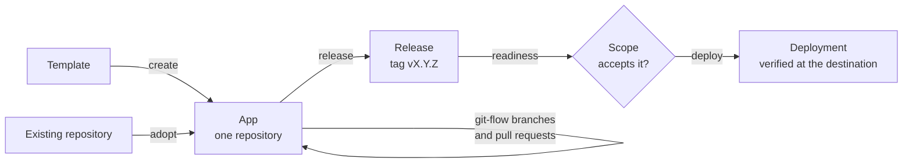

# Introduction

**Build. Standardize. Deploy.** Action Platform creates projects from templates, keeps every repository on the same git-flow, cuts versioned releases and deploys them to your cloud. You drive it from a web app, a CLI or an AI agent over MCP. It is open source (Apache-2.0) and you host it yourself.

## The problem

Every new service repeats the same setup: a skeleton, lint and test config, a CI pipeline, a versioning scheme, a deploy pipeline, cloud permissions. Each team does it a little differently. A year later, no two repositories release or deploy the same way, and nobody can say which version runs where.

Action Platform makes that setup one step and keeps it the same afterwards:

- A new app starts from a template with tests, lint, CI and `AGENTS.md` already in place.
- An existing repository joins through a pull request that adds the same files.
- Branches and commits follow one git-flow. Git hooks, CI and the code host refuse what breaks it.
- A deploy always ships a tagged release. The platform checks that the release can reach its destination before anyone deploys it, then verifies that the version arrived.

## Who it is for

| You are | You get |
|---|---|
| a developer | one command or one click for a new service, a branch, a pull request, a release or a deploy |
| a tech lead | the same branch, commit and release rules in every repository, enforced, with a changelog generated from the commits |
| a platform or DevOps engineer | templates, deploy targets and access rules you define once for the whole organization, on your own servers and cloud account |
| a manager or CTO | one place that shows every app, what was released, what runs in each scope, and who deployed it |

## What it does

| Capability | In short | Read |
|---|---|---|
| Templates | Start a web app, library, job, automation, docs site or browser extension in Python, Go, Node, Java, Kotlin, Ruby, PHP or Rust. Add your own template repositories. | [Templates](concept_templates.md) |
| Adoption | Bring existing repositories, or a whole GitHub organization, onto the platform without rewriting their history or their CI. | [Adopting repositories](use_adopting.md) |
| Git-flow | `<kind>/<code>` branches and Conventional Commits, checked by git hooks, CI and branch protection on the code host. | [Git-flow](concept_git_flow.md) |
| Releases | Semantic versions from `LAST_VERSION`, release candidates from any branch other than `main`, changelog, tag and host release in one step. | [Releases](concept_releases.md) |
| Scopes | Named destinations of an app (`dev`, `staging`, `prod-eu`) with a criticality that decides which releases they accept. | [Scopes](concept_scopes.md) |
| Deployments | Readiness checks before the deploy, a job that runs it, verification at the destination, a history of every deploy, whoever ran it. | [Deployments](concept_deployments.md) |
| Cloud identity | Deploys to AWS Lambda through OpenID Connect. The platform stores no AWS access key. | [Cloud identity](concept_identity.md) |
| Access | Organizations, teams and five roles. Tokens narrowed by scope and reach. Access to GitHub and other services kept in line with the roles. | [Access control](concept_access_control.md) |
| Plugins | Deploy targets, cloud overlays, tools and access providers shipped as Python packages. | [Plugins](use_plugins.md) |

## How it fits together

An **app** is one git repository on your code host (GitHub, GitLab, Bitbucket or another git server). The platform keeps a disposable clone of it and stores its configuration. A **release** is a tag on that repository. A **deployment** ships one release to one **scope**. [Core concepts](start_concepts.md) defines every term.

## Three ways in

All three use the same core library, the same `platform.toml` and the same git-flow rules.

| Surface | Use it for | Read |
|---|---|---|
| Web app | teams: projects, apps, releases, scopes, deployments, pipelines, members, connections | [Web](use_web.md) |
| CLI | your terminal: `init`, `branch`, `pr`, `release`, `readiness`, `deploy`, and more | [CLI](use_cli.md) |
| MCP server | AI agents such as Claude Code, Codex or Cursor, on a local repository or on a hosted platform | [MCP](use_mcp.md) |

## What it does not do

- It does not host your code. Repositories stay on your code host.
- It does not replace your CI. It reads the pipelines you run, starts them, and records what they deploy.
- It does not run your application. A deploy target puts the release in your cloud account, your Dokploy server or a package registry.

## Next steps

- [Quickstart](start_getting_started.md): a first project from the CLI in a few minutes.
- [Core concepts](start_concepts.md): the terms and how they relate.
- [Use cases](usecase_scaffolding.md): the problems teams solve with it.
- [Deploy from the web](guide_first_deploy.md): from a fresh instance to a verified deployment.
- [Self-hosting](start_self_hosting.md): run the platform for your team.
