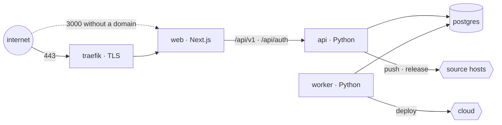

# Self-hosting

Three containers — Postgres, the Python API and the web app — plus a reverse proxy in front of the web app. Everything after `docker compose up` happens in the browser.

This page follows `master`, which can describe settings the newest images do not read yet. The page that matches what you run is in the docs of its tag: `https://github.com/actionplatform/action-platform/blob/api/vX.Y.Z/docs/start_self_hosting.md`. What an operator downloads (`install.sh`'s compose files, the release assets below) always comes from the same tag as the images it names.

## One command

On a fresh Ubuntu/Debian host, as root:

```bash
curl -fsSL https://raw.githubusercontent.com/actionplatform/action-platform/master/deploy/install.sh | sudo sh
```

- installs Docker when missing
- resolves the newest stable `api/vX.Y.Z` and `web/vX.Y.Z` releases (release candidates are skipped) and downloads `docker-compose.yml` and `.env.example` from the `api/vX.Y.Z` tag, the commit the api image was built from
- writes `/opt/action-platform/.env` with the settings and `/opt/action-platform/secrets/{postgres_password,better_auth_secret,api_token}` with fresh values (`openssl rand -hex 32`); the containers read them from `/run/secrets/*`, never from the environment
- `PUBLIC_URL=http://<public ip>:3000`, and the image versions as explicit tags: `AP_IMAGE_API`, `AP_IMAGE_WORKER` (both the api version) and `AP_IMAGE_WEB`
- `docker compose pull && docker compose up -d`, prints the URL

The compose files have no default image and no `pull_policy: always`: a missing `AP_IMAGE_*` stops `docker compose` with an error, and `docker compose up -d` (or a reboot) on an unchanged `.env` runs the same versions it ran before.

With a domain (DNS `A` record already pointing at the host) Traefik is added and Let's Encrypt issues the certificate:

```bash
curl -fsSL https://raw.githubusercontent.com/actionplatform/action-platform/master/deploy/install.sh | sudo sh -s -- platform.example.com you@example.com
```

Running the script again is the upgrade path — see [Upgrading](#upgrading).

Pin versions with `AP_REF` (api, worker and the compose files) and `AP_WEB_REF` (web); either one alone pins only that component and resolves the other:

```bash
curl -fsSL https://raw.githubusercontent.com/actionplatform/action-platform/master/deploy/install.sh \
  | sudo AP_REF=api/v0.41.2 AP_WEB_REF=web/v0.33.0 sh
```

## Dokploy

Dokploy already runs Traefik, so the compose file has no proxy and publishes no port. Two ways in.

Dokploy attaches compose services to the shared `dokploy-network`, where a service name resolves to any stack's container of that name. The Dokploy compose therefore names its services `ap-postgres`, `ap-pgbouncer`, `ap-migrate`, `ap-api`, `ap-worker`, `ap-worker-deploy` and `ap-web`, and the web app reaches the API at `http://ap-api:7788`, so a neighbour's `api` or `postgres` never answers in their place. To keep the stack off that network entirely, turn on **Isolated deployment** in the compose service settings before deploying; it is also the way to run two Action Platform stacks on one Dokploy host.

A service created from a template older than these names keeps its data (the `pgdata` volume is named after the stack, not the service): import the new template, point the domain at `ap-web`, deploy, and remove the old `postgres`, `api`, `worker`, `worker-deploy` and `web` containers if Dokploy left them running.

### Template (nothing to type)

`deploy/dokploy/` is a Dokploy template: `template.toml` declares the domain and generates `POSTGRES_PASSWORD` / `BETTER_AUTH_SECRET` / `AP_API_TOKEN`, and pins the images in `AP_IMAGE_API` / `AP_IMAGE_WORKER` / `AP_IMAGE_WEB`; `template.b64` is the two files packed for import.

Every stable `api/v…` and `web/v…` [release](https://github.com/actionplatform/action-platform/releases) carries the files to import, built by the image workflow once the images are pushed: `dokploy-template.b64`, `docker-compose.yml`, `docker-compose.dokploy.yml` and `env.example`, taken from the `api/vX.Y.Z` tag and pinned to that release and the newest stable release of the other component. Use the ones of the newest release that has them; release candidates get none. The `template.b64` on `master` is the source they are built from and can name other versions.

1. Project → **Create Service → Compose**, any name, *Create*.
2. In the service: **Advanced → Import Template** (or *Raw* → *Import*), paste the contents of the release's `dokploy-template.b64` (or of [`deploy/dokploy/template.b64`](../deploy/dokploy/template.b64) to run what `master` names), import. Compose, environment and the `ap-web` domain are filled in; the host is `<app>-<random>.<server ip>.traefik.me` until you change it.
3. **Domains**: edit the host to your domain, HTTPS on. Update `PUBLIC_URL` under *Environment* to match.
4. **Deploy**. Upgrades: change the `AP_IMAGE_*` tags under *Environment*, then *Redeploy*.

Regenerate `template.b64` after editing the compose or the toml: `sh deploy/dokploy/build.sh` — it also copies the compose to `deploy/docker-compose.dokploy.yml`, the file a Git-provider service reads; the two are one file.

### By hand

1. **Create Service → Compose**. Provider *Git*, repository `https://github.com/actionplatform/action-platform`, branch `master`, compose path `deploy/docker-compose.dokploy.yml`.
2. **Environment**: `PUBLIC_URL=https://platform.example.com`, `POSTGRES_PASSWORD`, `BETTER_AUTH_SECRET`, `AP_API_TOKEN` (`openssl rand -hex 32` each), and the images with explicit tags: `AP_IMAGE_API=actionplatformio/action-platform-api:X.Y.Z`, `AP_IMAGE_WORKER=actionplatformio/action-platform-worker:X.Y.Z` (the same version) and `AP_IMAGE_WEB=actionplatformio/action-platform-web:X.Y.Z` (the newest `api/v…` and `web/v…` [releases](https://github.com/actionplatform/action-platform/releases)). Save — the deploy fails with an unhealthy Postgres when the secrets are empty, and with `required variable AP_IMAGE_API is missing a value` when an image is.
3. **Domains → Add**: your host → service `ap-web`, container port `3000`, HTTPS on.
4. **Deploy**. Upgrades: change the `AP_IMAGE_*` tags under *Environment*, then *Redeploy*.

## The services



| Service | Image | Notes |
|---|---|---|
| `postgres` | `postgres:16-alpine` | volume `pgdata` |
| `api` | `actionplatformio/action-platform-api` | Python; keeps nothing on disk — clones are made under the container's temp dir when a request needs them and rebuilt from the code host any time. Reachable from `web`, which also forwards `/api/v1` and `/api/auth` to it. |
| `worker` | `actionplatformio/action-platform-api` | same image, `action-platform-api worker`: runs queued syncs, releases, deploys and imports. Stateless like the API: any host, any number — `docker compose up --scale worker=3`. |
| `web` | `actionplatformio/action-platform-web` | Next.js standalone, stateless: pages and server actions over the API. Port 3000. |
| `traefik` | `traefik:v3.3` | only with `--profile tls`; certificates in volume `letsencrypt` |

Images are published for every `api/vX.Y.Z` and `web/vX.Y.Z` tag to Docker Hub and mirrored to GHCR (`ghcr.io/actionplatform/…`). `.env` names the version of each: `AP_IMAGE_API`, `AP_IMAGE_WORKER`, `AP_IMAGE_WEB`.

## Environment

| Variable | Required | Meaning |
|---|---|---|
| `PUBLIC_URL` | yes | where browsers reach the app; also the OAuth callback origin |
| `POSTGRES_PASSWORD` | yes | Postgres password. `docker-compose.yml` mounts it as the `postgres_password` secret (`POSTGRES_PASSWORD_FILE` for Postgres, `AP_DB_PASSWORD_FILE` + `AP_DB_HOST` for the API, the workers and `migrate`, which assemble the URL themselves); Dokploy hands it through the environment. Only the optional PgBouncer needs it as a variable. The web app has no database connection |
| `ACTION_PLATFORM_GIT_HOSTS` | no | comma-separated hosts the API may clone from (`github.com,gitlab.example.com`; subdomains included). Empty allows any `https://` host. `ssh://`, `git@` and `file://` are always refused for user-supplied URLs; `AP_ALLOW_INSECURE_HTTP=1` admits `http://` for an internal GitLab. |
| `AP_GIT_AUTHOR_NAME`, `AP_GIT_AUTHOR_EMAIL` | no | fallback identity for commits when a request carries none (defaults `Action Platform <cloud@actionplatform.io>`). Each organization sets its own commit identity in Setup and Settings → Commit identity; the web app sends it with every call. |
| `AP_API_TOKEN` | yes | shared secret between web and API (`AP_API_TOKEN_FILE` points to a file with the value instead — the compose file uses `/run/secrets/api_token`): the API refuses every request without `Authorization: Bearer <token>` (except `/api/version`), so a neighbour on the Docker network cannot drive it. Set the same value on both services; unset, the API trusts the network (local development). |
| — | — | A `.env` in the working directory is read on start for every variable the shell did not set (the CLI, the MCP server, the API and the worker alike) — by the entry point, never by importing the library. |
| `AP_DATABASE_URL` | yes | the API's connection to the same Postgres (`postgres://…`, `mysql://…` or `sqlite:///…`); `AP_DATABASE_URL_FILE` reads it from a file, and without either the API assembles it from `AP_DB_HOST`, `AP_DB_PORT` (5432), `AP_DB_USER`, `AP_DB_NAME` (both `action_platform`) and `AP_DB_PASSWORD` or `AP_DB_PASSWORD_FILE`. Set, the API runs its migrations on boot and adopts the tables the web app created — see [database](concept_database.md). The compose file derives it from `POSTGRES_PASSWORD`; `AP_DATABASE_POOL_SIZE` (default 10) and `AP_DATABASE_MAX_OVERFLOW` (default 20) size its pool — every request holds one connection and some hold two, so keep the sum, across API and worker replicas, below the Postgres `max_connections`. |
| `AP_ALLOW_UNAUTHENTICATED` | no | `1` lets the API start without `AP_API_TOKEN` — local development only |
| `AP_SENTRY_DSN_API`, `AP_SENTRY_DSN_WEB` | no | Sentry DSNs, one project per component; empty keeps reporting off. Reaches the containers as `AP_SENTRY_DSN` (API) and `SENTRY_DSN` (web); `AP_SENTRY_ENVIRONMENT` / `SENTRY_ENVIRONMENT` and `*_TRACES_SAMPLE_RATE` (default 0.1) tune them. See [observability](concept_observability.md). |
| `BETTER_AUTH_SECRET` | yes | signs sessions, API tokens and encrypts stored tokens (source hosts, CI servers such as the Jenkins token a dispatched deploy starts builds with, secret plugin options) — rotating it invalidates all three. The compose files hand it to the API as `AP_AUTH_SECRET` (`docker-compose.yml` as the file `AP_AUTH_SECRET_FILE=/run/secrets/better_auth_secret`), with `PUBLIC_URL` as `AP_PUBLIC_URL` (the device-flow verification address, and the OIDC issuer: clouds read `<url>/.well-known/jwks.json` to trust deploy tokens — [identity](concept_identity.md)). |
| `DOMAIN`, `ACME_EMAIL` | with TLS | Traefik host rule and Let's Encrypt account |
| `WEB_PORT` | no | published port (default 3000) |
| `AP_DATABASE_AUTO_MIGRATE` | no | `0` keeps the API and the worker from migrating on boot — the compose files set it and run `db migrate` once in the `migrate` service |
| `GITHUB_CLIENT_ID/SECRET`, `GITLAB_*`, `BITBUCKET_*` | no | OAuth apps, read by the API; the ones entered in the UI (or created through the GitHub manifest) are stored in the database and win |
| `ACTION_PLATFORM_TEMPLATES_REPO` | no | templates matrix, default `actionplatform/templates` |
| `AP_SMTP_HOST`, `AP_SMTP_PORT`, `AP_SMTP_USER`, `AP_SMTP_PASSWORD`, `AP_SMTP_FROM`, `AP_SMTP_SECURITY` | no | SMTP server the API sends email through (password recovery). `AP_SMTP_SECURITY` is `starttls` (default, port 587), `ssl` (465) or `none`; `AP_SMTP_PASSWORD_FILE` reads the password from a file. Empty `AP_SMTP_HOST` means the API sends no email. |
| `AP_GOOGLE_CLIENT_ID`, `AP_GOOGLE_CLIENT_SECRET` | no | OAuth client (type Web application) of a Google Cloud project for "Continue with Google"; its authorized redirect URI is `${PUBLIC_URL}/api/sign-in/google/callback`. `AP_GOOGLE_CLIENT_SECRET_FILE` reads the secret from a file. Google signs in an existing account (matched by Google's account id, or by the verified email the first time) and creates one only for an email with a pending invitation. |

The setup wizard's first step only checks that the API has its database and secret; with the compose files it passes at once.

## Backups

One volume holds state: `pgdata` (accounts, organizations, projects, apps, encrypted tokens, OAuth apps, the registry, pending edits, jobs). Back up `pgdata`; keep `BETTER_AUTH_SECRET` (`secrets/better_auth_secret`) with it or the tokens cannot be decrypted. Clones live under the API's and worker's temp dir (`AP_WORKSPACES` to move them, `AP_WORKSPACE_TTL` seconds between fetches, default 15) and can be deleted at any moment. Capacity: `AP_API_WORKERS` uvicorn processes for the API (default 2 in the compose files; each keeps its own clone cache). Two worker services share the queue: `worker` takes sync, release, push and the imports (`AP_WORKER_CONCURRENCY` at once, default 2) and `worker-deploy` takes deploy, readiness and tear-down (`AP_DEPLOY_CONCURRENCY`, default 1) so a ten-minute deploy never holds a sync. The `api` image carries Python and git only; the `worker` image adds Go, Node, JDK and Ruby for the deploy targets plus `ap-build`, the one build entrypoint the cloud overlays call (`ap-build package` assembles a Lambda Web Adapter artifact for every language) — both published from the `api/vX.Y.Z` tag. Base images are pinned by digest and the API's Python dependencies install from `poetry.lock` with `--require-hashes`; the web image installs with `npm ci` — a release rebuilds exactly what the lock files say. `docker compose --profile pooler up -d` with `AP_DB_HOST=pgbouncer` (`ap-pgbouncer` on Dokploy) puts PgBouncer (transaction pooling, 500 clients) in front of Postgres when the replicas outgrow its connections. Every per-app listing and the queue's claim are indexed (migration 0014).

```bash
docker compose exec postgres pg_dump -U action_platform action_platform > backup.sql
```

## Building the images yourself

```bash
docker build -f deploy/Dockerfile.api --target api -t action-platform-api:local .
docker build -f deploy/Dockerfile.api --target worker -t action-platform-worker:local .
docker build -f deploy/Dockerfile.web -t action-platform-web:local .
AP_IMAGE_API=action-platform-api:local AP_IMAGE_WORKER=action-platform-worker:local AP_IMAGE_WEB=action-platform-web:local docker compose -f deploy/docker-compose.yml up -d
```

## Limits today

- The API image carries git, `sam`, the AWS CLI and the toolchains of every web language (Go, Node, JDK + Maven, Ruby) — 2.3 GB; the host needs room for it and for the build artifacts of deploys.
- Domains are set in `.env` (or in Dokploy), not from the app's Settings.
- Sync, release, readiness, deploy, destroy and import run as jobs on the worker; the rest of the calls run inline. Queued work is in [database](concept_database.md#jobs).

## Upgrading

Each component ships on its own tag and image: `api/vX.Y.Z` → `actionplatformio/action-platform-api`, `web/vX.Y.Z` → `actionplatformio/action-platform-web`, `vX.Y.Z` → `action-platform` on PyPI ([releases](concept_releases.md)). To upgrade:

1. Run `install.sh` again (with the same arguments, or none). It resolves the newest `api/v…` and `web/v…` releases (or the `AP_REF` / `AP_WEB_REF` you pin), prints `api <current> → <target>, web <current> → <target>`, and when either changes it dumps the database with `pg_dump` into `/opt/action-platform/backups/pre-upgrade-<UTC time>.sql` and prints that path. Then it downloads the compose files of the target api tag, writes the new tags into `.env` (everything else in `.env` and `secrets/` is kept), pulls and runs `docker compose up -d`. On Dokploy, change the `AP_IMAGE_*` tags under *Environment* and *Redeploy*. Upgrade the **api** before or together with the **web**: the web client is generated from the API's schema, so an older API may miss fields a newer web sends.
2. The compose `migrate` service applies the API's migrations before `api` and the workers start; nothing to run by hand.
3. Update the CLI where people use it: `pip install -U action-platform`. Tokens minted by `action-platform login` keep working across upgrades until they expire (90 days) or are revoked.

### Rolling back

Migrations only move forward, so going back to an older api means going back to the database from before the upgrade. In `/opt/action-platform`:

1. Set the previous tags in `.env` (`AP_IMAGE_API`, `AP_IMAGE_WORKER`, `AP_IMAGE_WEB`; the `api … → …` line `install.sh` printed has them).
2. If only the web changed, `docker compose up -d` is all. If the api changed, its migrations may have run: stop everything but Postgres, recreate the database from the dump and start again:

   ```bash
   docker compose stop web worker worker-deploy api
   docker compose exec -T postgres psql -U action_platform -d postgres \
     -c 'DROP DATABASE action_platform' -c 'CREATE DATABASE action_platform OWNER action_platform'
   docker compose exec -T postgres psql -U action_platform action_platform < backups/pre-upgrade-<UTC time>.sql
   docker compose up -d
   ```

Anything written between the upgrade and the restore is lost. Add `--profile tls` to each `docker compose` command when the instance has a domain.

`GET /api/version` on the API and the sidebar footer in the web app (`web · api · lib`) show what is running.
