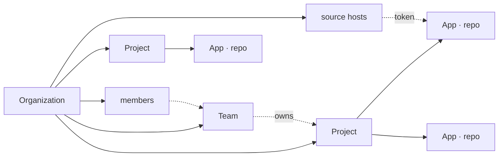
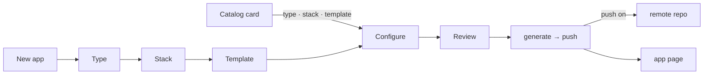

# The web app

Everything the CLI does, from a browser, for a team. The web app is a client of the API: every page reads through it, every action goes through it, and the API decides what you may do. One section per screen, in the order of the sidebar.

Every confirmation is an in-app dialog; the UI is monochrome, and colour appears only on status badges.

## The model



| Level | What it is | Owns |
|---|---|---|
| **Organization** | the tenant; the sidebar switches between the ones you belong to | members, teams, source hosts, projects, plugin settings |
| **Team** | a group of members (`platform`, `payments`) | projects — at most one team per project |
| **Project** | the apps that ship together (`orders-platform`) | apps |
| **App** | one git repository on a code host; the platform clones it when it needs the files and keeps nothing of its own | branches, releases, deployments, configuration |

## Sign-in

`/login` offers what the API is configured for:

- **Email and password** — always. The first account comes from the setup wizard, every other one from an invitation; public sign-up is closed.
- **Continue with Google** — on the login and invitation pages when the API has `AP_GOOGLE_CLIENT_ID` and `AP_GOOGLE_CLIENT_SECRET`. Google signs in an existing account (matched by its Google account, or by the verified email the first time, then linked) and creates one only for an email with a pending invitation; anyone else gets `no account for <email>: an owner has to invite you`. Before the first account exists it is refused: create that one with a password. The OAuth client's authorized redirect URI is `${PUBLIC_URL}/api/sign-in/google/callback`.
- **Forgot your password?** — under the form when the API has an SMTP server (`AP_SMTP_HOST`). `/forgot-password` takes an email and answers the same whether or not an account exists; an account with a password gets a link to `/reset-password`, valid 30 minutes. Setting the new password signs out every session of that account and revokes its API tokens, so the CLI and MCP servers signed in as it have to log in again. An account that has only ever used Google has no password to reset.

The variables are in [self-hosting › environment](start_self_hosting.md#environment), the errors in [troubleshooting › self-hosting](start_troubleshooting.md#self-hosting).

## First run: the setup wizard

`/setup` creates the first account and organization. Until an account exists it is open; afterwards it only serves the signed-in owner finishing the organization and source host steps, sends everyone else to `/login`, and sends a finished instance to `/projects`.

1. **API** — checks the API is reachable and configured.
2. **Admin** — the first account, after the **setup token** that proves you run the instance: `install.sh` prints it, and `action-platform-api setup token` in the API container prints it again ([self-hosting › first run](start_self_hosting.md#first-run)). Public sign-up stays closed afterwards.
3. **Organization** — name and slug.
4. **Source hosts** — connect GitHub / GitLab / Bitbucket, or skip ([Git](#git)).

Running by hand instead of the compose files: the wizard prints the values the API must start with. Migrations and readiness are in [self-hosting](start_self_hosting.md).

## People

A person of the platform shows as their display name wherever they acted — who deployed, who cut a release, who invited; the email only when the account has none (Members lists both on purpose). An account on a code host — the author of a pull request or of a release published there — shows as its login on that host.

## Dashboard

The home of an organization: four counters — apps, deployments today (and how many verified or failed), CI runs today (and how many failed), releases this week; **Deployments in progress**, every deployment still `queued` or `running` with its environment, status and the time since it started, refreshed every few seconds while one is active; the latest events across every app — releases, deployments, CI runs, pull requests — each linking to its tab; **Needs attention**, the deployment and CI failures of the day; and **CI coverage**, how many apps read a CI. Counters and events are read from the database and cached thirty seconds on the API; the deployments in progress are read on every request. A deploy the platform's worker runs itself (`run_by = "platform"`) writes its row when it ends, so it is not listed while it runs; one run by a CI shows once its run is synced.

## Projects

The organization's projects: search, sort, **Import** ([Import](#import)) and **New project**. A card shows the project's apps and team, with a menu to assign a team or delete. A project being torn down on the cloud says *Tearing down* until it is gone.

### The project page

The project's apps with their language and branch. **New app** opens the wizard; **Add an existing repository** takes a git URL; **Adoption** opens the install pull requests for many apps at once ([Adoption](#adoption)).

### Creating an app



1. **Type** — web, library, docs, plugin, empty
2. **Stack** — filtered by type
3. **Template** — `Default` marks the stack's default; custom templates carry their source name
4. **Configure** — name, description, project, source host and repository owner, licence (None by default: no `LICENSE`; MIT or Apache 2.0) and visibility (Private by default); CI provider, Docker overlay
5. **Review** — summary, visibility and licence, plus the equivalent `action-platform init …` command

The author in the manifest and the licence is the organization's commit identity (Settings), left empty while the organization has not set one.

*Create project* generates the app, creates the repository on the code host, pushes `main` and registers it — an app always lives on a code host, so the wizard needs a connected one. A template card under **Templates** opens the wizard at *Configure* with the first three steps filled in.

### Adding an existing repository

A git URL. With a `platform.toml` the app is registered as it is. Without one, the platform offers to install it: pick the type and the CI — **Detect from the repository** (the default) takes the CI the repository already runs, the same rules as [`install`](use_adopting.md), and a repository with two of them asks for one. When the installer found a CI in the repository or has a warning (a second CI next to an existing one), it shows them before anything else, with the stages to paste into a kept `Jenkinsfile`; **Open configuration** goes on. The app opens on Configuration with `platform.toml`, the quality config, the CI files and the hooks as **pending edits** — nothing pushed yet. **Commit changes** puts them on a `chore/<code>` branch with a pull request; **Discard changes** drops them. Pending edits live on the platform, not in a clone: they survive restarts and are applied on top of a fresh clone whenever the app's files are needed.

### Adoption

**Adoption** on the project page lists every app with where it stands — *not checked*, *no platform.toml*, *install PR #N open* with a link to it, *installed*, or *failed* with the reason — and the language, CI and version the last run found. Pick the apps (the ones not installed and without an open install pull request are picked already), the type, the CI (detected by default) and the language (detected by default; *No language* installs without the quality config), then **Install selected**. A job on the worker clones each repository and shows its plan: the files it creates and the ones it keeps, the CI it detected, the version `LAST_VERSION` starts at and where it comes from (a release tag, a manifest, the CHANGELOG, or an existing `LAST_VERSION`), and the branch it would use. **Open N pull requests** asks to confirm, then commits the files on `chore/platform` from the base branch (`develop` when the repository has one, else the default branch) and opens one pull request per repository; each app moves to that branch, as after **Commit changes**.

Each app runs on its own: one that fails — archived, no permission to push, a language the platform cannot detect, a `chore/platform` branch that already exists with no install pull request — is reported with the reason and the others go on. Running it again opens nothing twice: an app whose base branch has `platform.toml` is *installed*, one with its install pull request still open is skipped. An install pull request the code host reports merged reads as *installed* once the app's activity is imported; a closed one reads as *no platform.toml* again. Any member sees the list; previewing and opening pull requests need `project.manage`.

## The app page

The header carries the name, the branch, **Last synced** and **Sync** (or **Push to remote** while there is none). Tabs: Overview, Releases, Scopes, Deployments, CI, Activity, Settings — the path of a change, from its branch to where it runs. CI runs are also a filter of Activity.

### Overview

Branch, version, latest tag and deploy target; the **current branch** card; git-flow health of the branch and its commits, with a line saying whether the code host enforces git-flow for the app — **Active**, **Partly active**, **Drifted**, **Pending**, **Not active** with the host's reason, or **Not enforced** — and a link to Settings; last commits, remote branches with their kind, tags; source and automation.

The current branch card shows the latest imported CI run on the branch the app is on, with its status and a link to the run on the CI server (or **Connect CI** when the app reads none), **Run CI** to start the job on a branch or tag — a `workflow_dispatch`, a GitLab pipeline, a Bitbucket pipeline or a Jenkins build; the run shows after the next sync — and **Open pull request**. That button is enabled only when your role can work on the branch (`app.flow`), the app has a remote, the branch is a `<kind>/<code>` one with commits beyond its base, the tree is clean and no pull request from it is open; otherwise the card says which of these stops it, or links the open pull request. **Change branch** opens the same page to switch branch or start a new one.

**Open pull request** opens its own page: the branch the app is on (switch, or **New branch** for a `<kind>/<code>` one), **Prepare** audits git-flow and drafts the title and body from the commits, **Open pull request** confirms and opens it on the host; Overview then shows a banner with the link to review and merge.

### Sync

Fetches the remote and rebuilds the clone on the branch the app is on — the remote is the only source of truth. A branch deleted on the remote (its pull request merged) sends the app back to the default branch. Every request refreshes a stale clone on its own; **Sync** forces it now. Releases and pull requests are then copied from the code host in the background, so they may take a moment to appear.

### Releases

The tab lists the app's releases — version, tag, CI, author, commit, published — ten per page, paged on the API, with the page size to choose (10, 25, 50, 100); a row's menu opens **Timeline & readiness** — the readiness checks per stage with what failed and how to fix it, a **Re-check** button, then the pull requests merged since the previous tag, the release, the CI runs on the tag and the deployments that shipped it —, opens the release on the host, copies the tag or the SHA, shows the changelog. The CI column is the newest imported run on the tag, the version or the release commit, among the app's latest hundred runs; a release with none shows a dash. Readiness runs on the worker right after the release is cut; it looks at configuration, manifests, credentials, permissions and the destination's state and builds nothing — see [deployments › readiness](concept_deployments.md#readiness). **New release** opens its own page: Branch and Version (Patch / Minor / Major as a switch, the resulting version under each), Name and Markdown notes (they go into `CHANGELOG.md` and the release on the code host); a strip shows current → next, tag and kind. **Preview changelog** is the dry run; **Create X.Y.Z** asks to confirm (a Major asks twice) and shows the **release log** while the worker bumps, tags, pushes and publishes.

Refused when the tag exists, the branch is not on the remote, the tree is dirty or the branch policy fails. Off `main`/`master` it is an `-rc.N` pre-release. The model: [releases](concept_releases.md).

### Deployments

The tab lists the platform's deploys and tear-downs — status, stage, type, version, duration, who, when — ten per page, paged on the API; a row's menu opens the run — target, version, attempts, started, finished, who; the endpoint with copy and open; the **run log**, following the worker line by line while it runs; the deployment output as JSON — and **Redeploy** in its footer. What arrived at every target of the app, whoever shipped it, is in `GET /api/v1/projects/{p}/apps/{a}/deployments`, `action-platform deployments` and the `list_deployments` tool.

**New deployment** opens its own page: Release (with its shape — candidate, stable, hotfix) and Scope (with its criticality and what it accepts), a strip with target · release · scope · version, and the **readiness** of that release for that scope — *ready*, *blocked* with the failing checks and their fixes, or *not checked yet* — then **Run preflight** (checks only) → **Deploy to <env>**. A blocked release does not deploy until *Deploy anyway* is ticked; the API refuses it the same way (`409`) without `force`. The job runs on the worker and the row lands in the list at once; the form shows the **deploy log** as the worker writes it — `sam build`, `sam deploy`, the core's steps, or for a dispatched Jenkins target the queue item, the build number, each pipeline stage and the result — and keeps it after the run ends. One deploy at a time per environment: the button waits while one is live. A failure shows a compact alert with *View logs* and *Copy error*. Every deployment ships a release — a tag, never a branch. The model: [deployments](concept_deployments.md).

### Activity

What happened to the app, newest first: releases, deployments, CI runs and pull requests, the same events as the organization's [activity](#dashboard) for this app alone. Nothing is opened or started from here; **Sync** under CI runs only imports. Filters: **All** and **Releases**, **Deployments** (the latest fifty events of the kind); **CI runs**, the runs imported from the app's CI — status, run, branch, commit, trigger, when, duration, linked to the server — ten per page, with **Sync** to import the latest and **Connect CI** / **Change CI** for who can configure the app; **Pull requests**, state, title, head → base, author, when, ten per page from the code host's import; **Branch protection**, the rules applied on the code host, a drift put back by the hourly check (what differed and, when the host says, who changed it) or a refusal with its reason.

### Settings

One page with two tabs at the top, `?tab=general` and `?tab=ci`, no sub-menu in the sidebar.

- **General**: **Repository** (the remote repository, how releases are named, the source host whose token pushes and opens pull requests), **Branch protection** (whether the code host enforces git-flow — **Default** follows the organization, **On**, **Off**; only `app.configure` changes it — the protected branches, the required checks, who may still push, and each rule as *Enforced by the host*, *Required check* or *Not active* with the reason; **Apply now** applies the rules, **Check host** reads them again; see [git-flow on the code host](concept_git_flow.md#enforced-on-the-code-host)), **Deploy & services** and the **Danger zone**. **Deploy target** picks a cloud overlay for the app's type and language and applies it — the files become pending changes and `[deploy] target` is recorded; it is a form with a summary strip and a confirmation. **Services** lists the app's services (`action-platform service add` adds one on the CLI). **Configuration** edits `platform.toml` as the platform keeps it; **Export** writes the mirror into the repository. Pending changes are committed from the bar on top to a `chore/<code>` branch with a pull request, or discarded.
- **CI**: the runner — a **CI server** the organization connected under Settings (Jenkins), or the one embedded in the source host (GitHub Actions, GitLab CI, Bitbucket Pipelines, with the host's own token) — and the **job**: the path in the Jenkins URL (`team/app`, `team/app/main` for a multibranch branch), a workflow file such as `ci.yml` for GitHub Actions (empty means every workflow), nothing for GitLab and Bitbucket. Only `app.configure` saves it.

### Scopes

A deploy always lands on a **scope**: a named destination of the app with a kind (`web`, `job`, `worker`, `static`, `library`) and a criticality (`test`, `low`, `medium`, `high`, `critical`). No scope, no deploy — an app starts with none. The page lists the app's scopes — name, kind, criticality, what each accepts; **New scope** opens its own page: Name, Kind, Criticality (a switch with the definition of each level). A scope's menu edits or deletes it (refused while a deploy to it is running). Criticality decides which releases a scope takes: `test` and `low` take candidates, stable and hotfix releases; `medium` and above take stable and hotfix. Where the release goes — target, region, credentials — stays in Settings. The model: [scopes](concept_scopes.md).

### CI

The tab lists the runs imported from the app's CI — status, run, branch, commit, trigger, when, duration, linked to the server — ten per page, paged on the API; **Sync** imports the latest. **Connect CI** (later **Change CI**) opens the **CI** tab of the app's Settings.

### Deleting

Deleting an app or a project removes it from the platform. The dialog asks for the name and offers:

- **Delete repository on GitHub** (GitLab, Bitbucket) — deleted on the host first; when the host refuses, nothing is removed and the dialog says why. Branches, tags, releases and pull requests go with it; it cannot be undone.
- **Also tear down `<target>`** (app) / **Delete stacks on the cloud** (project) — the stacks are deleted through the target first, then the app or project leaves the platform; a failure leaves it in place with the error on Deployments.

Which hosts can delete, and what a tear down does: [troubleshooting](start_troubleshooting.md#git-hosts) · [deployments](concept_deployments.md#leaving-the-cloud).

## Templates

The catalog: the official repository plus the ones the organization added under **Template repositories** (owners and admins; any git repository is one template, or a whole catalog with an `index.json`). A project card opens the wizard; a cloud card opens *Apply to app*. Sources and overlays: [templates](concept_templates.md).

## Import

**Import** (admins, from Projects) brings a GitHub organization, a GitLab group or a Bitbucket workspace — or the connected account's own repositories — in through a connected code host of that kind (a self-hosted GitLab through the host's base URL). Pick the host and the organization, group or workspace; the page lists what the token sees:

- **Projects** become projects and their repositories become the apps: GitHub Projects, GitLab subgroups (one project per subgroup, with the repositories directly in it) and Bitbucket projects.
- **Repositories** become one project each, or all go into one existing project.
- **Teams** become teams — GitHub teams and GitLab subgroups (their direct members) — their members already on the platform join them, and the ones invited join on accepting. Bitbucket Cloud's API does not list a workspace's groups, so a Bitbucket import offers no teams.
- **People** join at once when an account with their public email exists. Otherwise they are invited: by email when the host shows one — and when the API has `AP_SMTP_HOST` set, that email is sent, the same one **Invite** sends — else by their login on the host (never emailed: it has no address). Bitbucket never shows emails, and GitLab only a public one, so on those hosts most people are invited by login. A login invitation is accepted on its invitation page by signing in (or creating an account with any email) and then **Verify @login** on the host — the platform's OAuth app for that host proves the account is theirs. On Bitbucket and GitLab the invitation is bound to the account's immutable id (Bitbucket uuid, GitLab numeric id), not to the displayed name: someone who renames themselves to the invitee's name does not get in. Without that OAuth app on the platform there is nothing to verify with, so those people are listed as *No email* for you to invite by hand.
- **Roles** come from the host: each person shows their role there — GitHub organization owner, team maintainer or member; GitLab owner, maintainer or below; Bitbucket workspace owner or member — and the role they will get. The mapping above the list sets the platform role for each (all *Developer* until you change it); the selector on a person overrides it for them. People already in the organization keep their role.

Invitations carry the teams: a person invited by the import who accepts later — a day or a week after — joins the imported teams the host had them in. **Organization › Members** lists each pending invitation with its email or `@login`, whether the email went out, its role and the teams waiting for it. Without `AP_SMTP_HOST` no email is sent and the link there is the way in.

The preview starts with what the host cannot provide (the emails, the teams) so nothing missing comes as a surprise.

Repositories already on the platform cannot be picked twice. On GitHub, teams and people need the GitHub App permission *Organization › Members (read)* or the `read:org` scope; the page says so when GitHub refuses. The import runs in the background and ends with what was created: projects, apps, teams, who joined, who was invited by email and by login, the teams waiting for each invitee, and what was skipped with the reason. When the repositories went into one project, **Open install pull requests for N repositories** leads to that project's [Adoption](#adoption); otherwise each imported project has its own.

## Organization

Three pages — on a phone, three tabs.

### Teams

Members (organization members only) and projects; a project belongs to at most one team, assigned here or from the project card. Deleting a team leaves its projects without one.

### Members

People, roles and invitations. **Add member** creates the account or attaches an existing one; **Invite** produces a link (valid 7 days, bound to the email). When the API has `AP_SMTP_HOST` set it also emails the person: the organization, who invited them, the role, the expiry and the link to `/invite/<id>`, plus a line that they can accept with Google when *Continue with Google* is configured; the dialog says whether the email went out, and still shows the link to share by hand. Without `AP_SMTP_HOST` nothing is sent and the link is all there is. Pending invitations show the email as *Sent* or *Not sent* with the reason (a failed send never fails the invitation), and **Resend** sends it again — same invitation and link, expiry renewed to 7 days from now. Login invitations are not emailed. The roles table is on this page; the rules in [access control](concept_access_control.md).

### Sessions

Everything signed in as you (also the key icon next to your name): API tokens across organizations — scope, reach, the programs using them, last used, expiry — and browser sessions, each revocable at once. **New token** creates a bearer token for a machine with no browser to approve a login: a name, the scopes your role allows and the reach (one organization or all, optionally one project or app); it is shown once, valid 90 days (30 with Admin), and goes to `action-platform login <url> --token` or `AP_TOKEN`.

The **Password** card changes your own password: the current one and a new one of at least 8 characters, typed twice. A wrong current password changes nothing. This browser stays signed in; every other browser session ends and every API token of yours is revoked, so the CLI and the MCP servers signed in as you have to log in again. An account that has only ever used Google has no current password to give: use *Forgot your password?* or ask an operator ([operations](start_operations.md#users-and-tokens)).

## Plugins

One card per plugin the platform runs, with its version. **Configure** opens the settings the plugin declares, kept per organization; a plugin that failed to load shows the error. There is no marketplace: a plugin ships inside the platform's image ([plugins](use_plugins.md)).

**AWS Lambda** asks for the ARN of the deploy role your connected AWS account's IAM-only stack created; every deploy of the organization assumes it. Connecting the account: the [apx-aws-lambda](https://github.com/actionplatform/apx-aws-lambda) README; how it works: [identity](concept_identity.md).

## Settings

**Organization** — name, slug, your role, the commit identity, the git-flow rules and the **branch protection default** (On or Off for apps whose own setting is Default; `org.manage` changes it) — **Git** and **Services**; **Access** and **Instance** are tabs of the same page (`?tab=access`, `?tab=instance`), with no sub-menu; a tab the viewer may not use is not listed.

### Commit identity

Name and email the platform commits with on its clone (releases, configuration), chosen in Setup and editable here. Stored per organization; every commit the platform makes carries it.

### Git

GitHub, GitLab and Bitbucket, connected per organization — organization A can connect a personal account, organization B the company's; nothing is shared.

**GitHub in two clicks**: *Create GitHub App* opens GitHub with the manifest pre-filled; confirm, then *Install the app* on the account or organization whose repositories it should manage, and *Connect with GitHub*. **Install on another organization** adds more accounts later; each one becomes selectable as the repository owner in the wizard. The GitHub App is public, so it installs on any account you administer.

Otherwise register an OAuth app once (*Set up OAuth app* shows the callback URL to paste):

| Provider | Where |
|---|---|
| GitHub | Settings → Developer settings → OAuth Apps (*I already have one*) |
| GitLab | Preferences → Applications, scopes `api write_repository read_user` |
| Bitbucket | Workspace settings → OAuth consumers: account; repositories write/admin; pull requests write |

Then **Connect with …** signs the organization in with your account; the wizard offers your user plus every group (GitLab) or workspace (Bitbucket) you can create in. *Add with a token* is the manual path (kind, base URL for self-hosted instances, token, default owner); *Other* is any git server over HTTPS — push and tag only.

GitHub access under **Access** runs on this connection, never on a pasted token: the connection's default owner is the GitHub organization it manages, and the connected account must be an owner of it. Connecting GitHub asks for `admin:org` among the platform's scopes, and a GitHub App created from the manifest carries Organization *Members: Read and write* and Repository *Administration: Read and write*. For an app created without them, the account's line names the missing permission: add it in the app's *Permissions & events*, then accept the new permissions on the installation. A plugin that manages access on another code host reads the connection the same way, and connecting asks for the scopes it declares on top of the platform's own.

Tokens are encrypted by the API and never leave it; expiring tokens are refreshed before use. The list shows each account, where the app is installed and the default owner the wizard pre-selects; apps remember which host they use. *Webhook…* shows the payload URL and generates the secret (shown once) to paste on the host — GitHub: pushes, pull requests, releases, workflow runs; GitLab: push, tag, merge request, release, pipeline; Bitbucket: push, pull requests — after which every event syncs the app within seconds. *Remove host* disconnects an account.

### Services

Services other than code hosts that plugins read through a connection instead of a pasted token. **Sentry**: *Set up OAuth app* shows the callback URL; create the application once in Sentry (User settings → API → Applications → *Create New Application*, Confidential, that callback as the redirect URI) and paste its client id and secret. Then *Connect Sentry* signs the organization in with your Sentry account, asking for the scopes the installed plugins declare. The token is sealed and refreshed before it expires; the card names any scope a plugin needs that was not granted (*Reconnect* asks again). *Disconnect* deletes it.

### Access

The **Access** tab of Settings (`org.manage` only; hidden from others) manages what members may do on the organization's GitHub (through the GitHub connection under Git) and on the services the plugins own, through [service access](concept_service_access.md). Read from each service on every load:

- **Per service** — readable or not (a failure shows the plugin's error as it came; when it asks to connect something, a link opens Settings, where Git and Services are connected), whether it is imported, the grants it holds against the grants the mapping wants, the drift a sync would close, members without an account, accounts that belong to no member, and the levels of each resource kind.
- **Who has access** — by person (email: accounts, teams, live grants, drift) or by service (every account and the member it belongs to).
- **Change access** — sync, grant, revoke and offboard (optionally removing the person from the organization too). Each first runs as a dry run and shows the plan, a change per row with its status, refused ones highlighted with the reason; **Apply** asks for a confirmation and runs it for real, then shows what was applied or failed. A sync of a service not yet imported only imports it and changes nothing there. Linking members to accounts that are not their email (`links`) is not on the page.

### CI servers

Build servers of their own, per organization: name, base URL, username and API token (Jenkins → your user → Security → API Token). *Test* reaches the server with the sealed token. GitHub Actions needs nothing here. Apps pick a server and a job under their Settings › CI; removing a server leaves the imported runs and disconnects the apps that pointed at it. The same server is what a deploy uses to start a dispatched Jenkins target (`observe = false`, [deployments](concept_deployments.md#dispatched-jenkins-jobs)): give its user *Overall/Read* plus *Job/Read* and *Job/Build* on the deploy jobs only — nothing more is called.

### Instance

The **Instance** tab of Settings (owners only; hidden from others) answers "is this instance OK?": database and migrations, whether a worker runs for each kind of job, every worker with its last heartbeat, the queue of your organization per kind with the age of the oldest waiting job, and what is configured — email, Google sign-in, error reporting on the API and the code-host OAuth apps. It refreshes every ten seconds. **Send test email** sends a message to you and shows the SMTP server's error text when it fails. For Google sign-in it shows the redirect URI to add to the OAuth client, with a copy button. A job that waits with no worker taking its kind shows "No worker running" in the deployments table and in its log; see [observability](concept_observability.md#instance-health).

### Delete organization

At the bottom of Settings, an **owner** can delete the organization: type its slug, choose whether the repositories on the code hosts go too and whether the deploy stacks are torn down first (a job on the worker; the organization leaves when every stack is gone), confirm. Projects, apps, members, teams, invitations, connected hosts, CI servers, template sources, plugin options, tokens and history go with it; sessions pointing at it move to your next organization. `DELETE /api/v1/organizations/{id}?confirm=<slug>&repositories&cloud` is the API.

## CLI and MCP against a hosted instance

```bash
action-platform login https://platform.example.com   # device flow: approve a code at /device
action-platform whoami
action-platform mcp --remote
```

The approval page (`/device`) names the client, shows the code to compare with the terminal, lists the scopes asked for — read, write, release, admin, cut to what your role may grant — and where the token may act: one organization or all of them, optionally one project or one app. An expired code (ten minutes) cannot be approved. What you approve becomes the token's scope and reach; every call then needs both your role and that scope — [access control](concept_access_control.md).

## Old paths

`/settings/people` → `/organization/members` · `/settings/people/teams` → `/organization/teams` · `/integrations`, `/integrations/hosts`, `/settings/integrations` → `/settings` · `/integrations/cloud` → `/plugins` · `/settings/developers`, `/account` → `/organization/sessions` · `/settings/access`, `/settings/instance` → `/settings?tab=access`, `/settings?tab=instance`.

Inside an app: `…/settings/ci` and `…/ci/connect` → `…/settings?tab=ci` · `…/settings/scopes`, `…/settings/scopes/new`, `…/settings/scopes/<name>` → `…/scopes/…` · `…/settings/configuration` and `…/configuration` → `…/settings?tab=general` · `…/activity/new` → `…/pull-requests/new`.

## Hardening

Security headers on every response (CSP, HSTS, no framing), no cross-origin cookie-authenticated writes, rate limits on sign-in and device polling, OAuth state bound to the signed-in user, only same-origin redirects, timeouts on every call to a code host and to the API.
