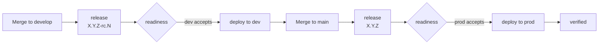

# Delivery automation

Turn merged work into a versioned release, check it against each destination, deploy it and confirm it arrived.

## Context

An app moves from a branch to a test environment to production. Versions, changelogs, tags and deploys are handled by scripts that differ per repository.

## Challenge

Nobody is sure which version runs where. A deploy fails halfway because a permission is missing. A pipeline turns green, but the new version never reached the registry. Production gets a build of a branch that no tag can reproduce.

## Solution

| Step | What the platform does |
|---|---|
| Release | computes the next version from `LAST_VERSION`, renders the changelog from Conventional Commits, writes the files, tags, pushes and publishes the release on the code host |
| Readiness | checks the release against every scope of the app, without building: release shape, manifests, credentials, permissions, destination state |
| Deploy | runs as a job on the worker, from the release tag, through the scope's target; or dispatches the CI workflow or Jenkins job that deploys |
| Verify | asks the destination for that exact version: PyPI, npm, a container registry, Packagist, the Go proxy, the Lambda stack |
| Record | keeps every deployment with its status, executor, log and who ran it, including deploys an existing pipeline made on its own |

## Workflow

1. Cut a release candidate on `develop` and deploy it to `dev`.
2. Merge to `main`, cut the stable release and deploy it to `prod`. A candidate aimed at a `high` scope is refused.
3. Roll back by deploying an older release.

## Benefits

- Every deployment ships a tag, so what runs is reproducible from the tag alone.
- Problems surface on the release page before the deploy, each with its fix.
- `success` and `verified` are separate: a green pipeline that published nothing is visible.
- One deploy runs per scope at a time; another scope goes ahead.
- Existing pipelines keep working. The platform records what they ship.

## Related features

[Releases](concept_releases.md) · [Scopes](concept_scopes.md) · [Deployments](concept_deployments.md) · [Cloud identity](concept_identity.md)

## Getting started

[Deploy from the web](guide_first_deploy.md) walks from a fresh instance to a verified deployment.
