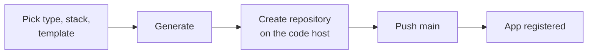

# Project scaffolding

Start every new service, library or job from the same tested skeleton, in one command or one click.

## Context

A team creates new repositories regularly: a service for a new domain, a shared library, a scheduled job, a docs site.

## Challenge

Each new repository is set up by hand or copied from the last one. Lint rules, test layout, CI files and versioning differ between repositories. Fixes made in one never reach the others, and the first week of every project goes to setup instead of features.

## Solution

Action Platform creates the repository from a template chosen by type, stack and template. Every official template ships tests, lint and quality config, CI for GitHub Actions, GitLab CI, Jenkins or Bitbucket Pipelines, `platform.toml`, `LAST_VERSION` and `AGENTS.md`. A cloud overlay (`aws/lambda`, `dokploy`, `docker`) and services (`postgres`) are added on top, at creation or later. An organization can add its own template repositories next to the official catalog.

## Workflow



1. Pick the template: `action-platform init --list`, the **Templates** catalog, or **New app** in a project.
2. Name the project and choose the CI, the licence and the visibility.
3. The platform renders the template, creates the repository on GitHub, GitLab or Bitbucket and pushes `main`.
4. On the hosted platform the repository becomes an app of the project, ready for branches, releases and deploys.

## Benefits

- A new repository has working tests, lint and CI from its first commit.
- Every repository uses the same layout and the same CI steps, so moving between them costs nothing.
- `AGENTS.md` tells people and AI agents the commit, branch and layout rules of the repository.
- Cloud deploy files are a layer: switching from `docker` to `aws/lambda` is one command, not a rewrite.

## Related features

[Templates](concept_templates.md) · [platform.toml](concept_manifest.md) · [Git-flow](concept_git_flow.md) · [Add your own templates](guide_custom_templates.md)

## Getting started

```bash
action-platform init web python fastapi --name orders --cloud aws/lambda
```

Or follow the [Quickstart](start_getting_started.md).
